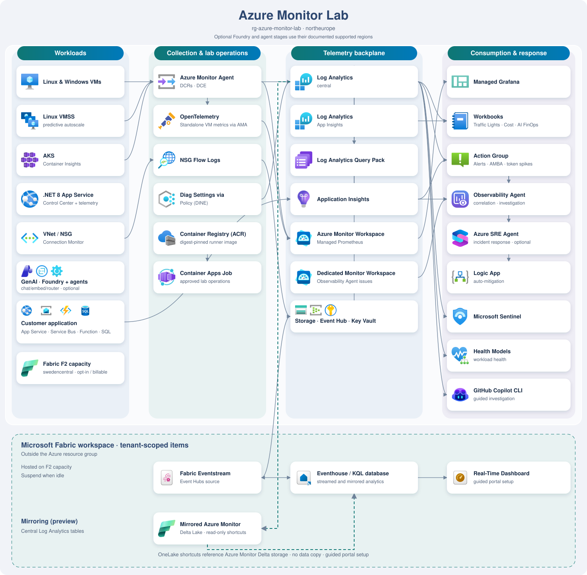

<h1 align="center">
  
</h1>

A self-contained demo centered on Azure Monitor, AI, Azure Copilot Observability Agent, and Azure SRE Agent, with optional Microsoft Sentinel and Microsoft Fabric Real-Time Intelligence scenarios. Everything runs from a single config file that stays out of git, so you can stand the whole thing up in your own subscription and tear it back down when you're finished.

- One primary resource group: Azure resources land in `rg-azure-monitor-lab`; AKS has a managed resource group, and Fabric workspace items and Entra registrations are tenant-scoped.
- Two ways to deploy it: Bicep or Terraform.
- Three ways to deploy it: a [Deploy to Azure](#option-1-deploy-to-azure-portal-no-local-setup) portal wizard, a scripted one-shot deployment using PowerShell, or a five-stage core workshop with optional AI, SRE Agent, Observability Agent, and Fabric extensions.
- **80 numbered demo scenarios**, plus a 30-second introductory pitch, covering Azure Monitor, agentic-application observability, customer application dependencies, GitHub Copilot CLI, Azure SRE Agent, and Fabric Real-Time Intelligence.

It's built for demos, microhacks, and hackathons. Deploy it, poke around, break it, restore it, and tear it down.

## Use The Lab

| Experience | Start here |
|---|---|
| **Guided Scenarios** | Follow the existing [scenario walkthroughs](docs/DEMO-SCENARIOS.md) for the story, Azure portal steps, queries, and expected results. |
| **Lab Control Center** | Check infrastructure health, generate traffic, try Foundry agents, and perform approved SRE MCP operations. Open the [Control Center guide](docs/LAB-CONTROL-CENTER.md) for screenshots, access requirements, and linked scenarios. |

These are complementary entry points into the same lab. The Control Center links to the guided scenarios; it does not replace their setup or walkthroughs.

### Scenario coverage

Explore the [guided scenarios](docs/DEMO-SCENARIOS.md) for walkthroughs, queries, and expected results. Optional scenarios require their corresponding stages, permissions, and preparation.

## Architecture

The lab combines application, infrastructure, and AI workloads with Azure Monitor to demonstrate end-to-end observability, alerting, troubleshooting, and agent-assisted operations. See the [resource inventory](docs/REFERENCE.md#what-gets-deployed) for deployed components.

[](docs/architecture.drawio)

## Prerequisites

- An active Azure subscription
- Azure permissions to deploy resources and create custom roles and role assignments, plus Microsoft Entra permissions to manage the application and service principal used for Control Center sign-in and validate operator users. See [console deployment prerequisites](workloads/webapp/LAB-OPERATIONS.md#prerequisites) for details; Azure ownership does not override tenant restrictions on application registration.
- Azure CLI (`az`) 2.60 or later, logged in with `az login`
- `kubectl` (any recent version)
- Bicep CLI (bundled with `az` 2.20+), or Terraform 1.6+ if you take the Terraform path
- PowerShell 7+
- .NET 8 SDK for publishing the Control Center
- Optional AI stage: [Python 3.10+](https://www.python.org/downloads/)
- Optional SRE Agent stage: [npm](https://docs.npmjs.com/downloading-and-installing-node-js-and-npm) and [tar](https://www.gnu.org/software/tar/)

## Deploy

### Option 1: Deploy to Azure (portal, no local setup)

First, open **[Cloud Shell](https://learn.microsoft.com/en-us/azure/cloud-shell/get-started/ephemeral?tabs=azurecli#start-cloud-shell)** in **PowerShell** and prepare the shared Network Watcher. Use the same subscription and region in the portal wizard:

```powershell
git clone --branch main https://github.com/Azure-Samples/azure-monitor-lab.git
cd azure-monitor-lab
$ErrorActionPreference = 'Stop'
$PSNativeCommandUseErrorActionPreference = $true
$tenantId = Read-Host 'Tenant ID'
$subscriptionId = Read-Host 'Subscription ID'
$resourceGroup = Read-Host 'Resource group name'
$location = Read-Host 'Azure region (for example northeurope)'
$namePrefix = Read-Host 'Name prefix (press Enter for amlab)'
if ([string]::IsNullOrWhiteSpace($namePrefix)) { $namePrefix = 'amlab' }
az login --tenant $tenantId --use-device-code --output none
az account set --subscription $subscriptionId
. ./scripts/network-watcher.ps1
Ensure-LabNetworkWatcher -SubscriptionId $subscriptionId -TenantId $tenantId -Location $location -Confirm
```

Existing shared resources are preserved; only a missing group/watcher is created. Then open the wizard:

<div align="center">

[](https://portal.azure.com/#create/Microsoft.Template/uri/https%3A%2F%2Fraw.githubusercontent.com%2FAzure-Samples%2Fazure-monitor-lab%2Fmain%2Finfra%2Fmain.json/createUIDefinitionUri/https%3A%2F%2Fraw.githubusercontent.com%2FAzure-Samples%2Fazure-monitor-lab%2Fmain%2Finfra%2FcreateUiDefinition.json)

</div>

Opens a guided Custom deployment wizard in the Azure Portal, where you enter every value in the UI and don't need any local files. Sensible defaults are pre-filled throughout; the only things you have to supply are an alert email and a VM admin password.

This button deploys the stable `main` templates. Use completion scripts from the same release; changes merged into `integration` reach this button only after promotion to `main`.

| Tab | You provide |
|---|---|
| **Basics** | Resource group (recommended `rg-azure-monitor-lab`), Region (recommended `northeurope`), name prefix, alert email, VM admin username + password |
| **Workloads** | Deploy Linux/Windows VMs, VM size, AKS node size + count |
| **Monitoring & cost** | Daily ingestion cap, Sentinel, platform-logs/metrics-export DCRs, LAW replication |
| **Advanced** | Owner tag, optional Grafana administrator object ID, App Service sample repo, optional SIEM/Teams webhook, optional AI, SRE Agent, and Observability Agent stages |

After the portal deployment succeeds, return to the same Cloud Shell session and complete the post-deployment configuration:

```powershell
./scripts/post-cloud-shell-deploy.ps1 -TenantId $tenantId -SubscriptionId $subscriptionId -ResourceGroup $resourceGroup -NamePrefix $namePrefix
```

The wrapper detects deployed optional integrations, including Fabric, and reports any remaining manual actions. If the Cloud Shell session expired, reopen the clone and restore the variables above without repeating deployment.

If you enabled the optional AI stage and want to generate AI telemetry, run this next from the same Cloud Shell session. Skip it when AI is disabled:

```powershell
./scripts/setup-ai-cloud-shell.ps1 -SubscriptionId $subscriptionId -ResourceGroup $resourceGroup -NamePrefix $namePrefix
```

After the wrapper succeeds, deployment is complete. Continue with the [manual scenario setup](docs/POST-DEPLOYMENT.md) for only the scenarios you plan to present.

### Option 2: Scripted one-shot (Bicep / Terraform, full control)

```powershell
# 1. Clone the repo and enter it
git clone --branch main https://github.com/Azure-Samples/azure-monitor-lab.git
cd azure-monitor-lab

# 2. Copy the template and fill in basicConfiguration for your subscription
Copy-Item lab.config.json.example lab.config.json
notepad lab.config.json
# Save your changes and close Notepad before continuing.
# One-shot ignores enableStageA-E; AI, SRE Agent, Observability Agent, and customer scenarios remain optional.

# 3. Deploy (deploy.ps1 calls sync-config.ps1 for you)
./scripts/deploy.ps1
```

Fill in `basicConfiguration` in your local `lab.config.json` for a default deployment, including the resource group and regions. `advancedConfiguration` groups compute sizes, monitoring, access, and optional stage toggles. Existing flat configs still work. Defaults are `rg-azure-monitor-lab` and `northeurope`; the group is created or reused. Deployment can take tens of minutes and includes Control Center setup and selected optional agents. See [config layout](docs/REFERENCE.md#config-layout-and-compatibility) and [deployment reference](docs/REFERENCE.md#deploy).

<details>
<summary><b>VM and AKS node SKU choices</b></summary>

New portal, Bicep, Terraform, and scripted defaults match the [config example](lab.config.json.example): `Standard_EC2as_v5` for VMs and VMSS, and two `Standard_EC4as_v5` AKS system nodes. Existing explicit config values are preserved. These confidential-compute choices are not burstable or guaranteed for every subscription/region. Adjust `vmSize`, `vmssSize`, and `aksNodeVmSize` under `advancedConfiguration.compute` for availability and quota; VM/VMSS replacements must support the templates' confidential-VM security settings. Pre-flight checks availability, quota, and AKS system-pool minimums, not all service-specific compatibility requirements, and does not select replacements automatically.

</details>

<details>
<summary><b>Pre-flight check</b> (region SKU / quota validation before deploy)</summary>

Before creating anything, `deploy.ps1` runs [`scripts/preflight-check.ps1`](scripts/preflight-check.ps1), which checks in about 15 seconds that every VM SKU, vCPU quota, and PaaS resource type the lab needs is actually available in the region you picked for your subscription. It fails fast with a PASS/WARN/FAIL table instead of blowing up 20 minutes into the deployment. You can run it on its own to vet a region before committing (`./scripts/preflight-check.ps1 -Location westeurope`), or skip it with `./scripts/deploy.ps1 -SkipPreflight`.

If compute checks fail, pre-flight names the config keys to edit and lists candidates from a curated shortlist using the subscription's live SKU inventory and quota. Candidates are not automatically selected, price-ranked, or guaranteed to pass service-specific deployment validation. Their headroom is checked per setting; rerun deployment after editing to validate combined demand. The VMSS quota check covers its initial instance, not its autoscale maximum. A standalone pre-flight invocation uses its command-line defaults, not your local config; to check the example sizes explicitly:

```powershell
.\scripts\preflight-check.ps1 -Location northeurope -VmSize Standard_EC2as_v5 -AksNodeVmSize Standard_EC4as_v5 -AksNodeCount 2 -VmssSize Standard_EC2as_v5
```

For **insufficient quota**, open Azure Portal > Quotas > Compute, select the checked subscription and region, and request a new total family/regional vCPU limit covering existing usage plus lab demand. For **NotAvailableForSubscription**, more quota may not remove SKU restrictions: use an eligible size or region, or request SKU access through Help + support if needed. Do not copy an EC2as_v5 workaround into AKS: system pools require non-B-series nodes with at least 4 vCPUs and 4 GiB RAM, and at least two nodes ([AKS requirements](https://learn.microsoft.com/azure/aks/use-system-pools)). Keep pre-flight enabled rather than bypassing known blockers.

The pre-flight checks *availability and quota*, not *live service capacity*. Transient, region-wide shortages like AKS `AksCapacityHeavyUsage` have no pre-check API and only surface at deploy time. If one hits, change `location` in your local `lab.config.json` or retry (`-MaxDeployRetries 3`), since capacity frees up as other clusters are deleted.

</details>

**Deployment blocked by region access?** For `RequestDisallowedByAzure` / "The selected region is currently not accepting new customers", change the affected region in your local `lab.config.json` and rerun deployment. `location` controls the main infrastructure; `appServiceLocation` controls web apps, customer dependencies, diagnostic storage, and Event Hubs; `observabilityAgentLocation` controls the optional Observability Agent and its workspace. Region eligibility varies by subscription and service. Changing config does not move existing resources: after a partial deployment, review what was created and use a new resource group when resources cannot be relocated. See [known issues and recovery steps](docs/REFERENCE.md#troubleshooting), including SKU/quota restrictions, stopped AKS, and Fabric update failures.

A successful `deploy.ps1` run completes the selected setup. Continue with the [manual scenario setup](docs/POST-DEPLOYMENT.md) for only the scenarios you plan to present.

### Option 3: Staged workshop (progressive deployment)

Use the staged approach when you want to pause between capabilities, walk through the lab with an audience, or deploy only the stages needed for a particular demo. Select stages under `advancedConfiguration.stageToggles` in `lab.config.json` (`stageToggles` in legacy flat configs). The optional AI, SRE Agent, Observability Agent, and Fabric stages have separate toggles and prerequisites. Bicep deploys SRE Agent with `infra/stages/60-sre-agent.bicep`; Terraform deploys the compiled stage when `enable_stage_sre_agent = true`.

Step-by-step guides:

- [Bicep staged deployment](docs/DEPLOY-BICEP-STEP-BY-STEP.md)
- [Terraform staged deployment](docs/DEPLOY-TERRAFORM-STEP-BY-STEP.md)

Each staged guide includes the required completion command for every selected stage. After completion, use the [manual scenario setup](docs/POST-DEPLOYMENT.md) for only the scenarios you plan to present.

### Lab Control Center

The [Lab Control Center](docs/LAB-CONTROL-CENTER.md) runs in the lab's existing **Web App**. Use it to control the lab from your browser, including starting, breaking, and restoring it.

Retrieve its URL in PowerShell or Azure Cloud Shell (PowerShell):

```powershell
$subscriptionId = Read-Host 'Subscription ID'
$resourceGroup = Read-Host 'Resource group name'
az webapp list --subscription $subscriptionId --resource-group $resourceGroup --query "[].defaultHostName" --output tsv | ForEach-Object { "https://$_" }
```

## Cost and lifecycle

> [!WARNING]
> **Ballpark:** Stages A-E: **EUR 6-10/day**; optional capabilities with light AI and agent use: **EUR 10-25/day**, assuming an eligible SRE Agent trial and automatic Observability Agent investigations remain off. These September 2026 estimates are not quotes or spending caps; region, telemetry, traffic, and usage can increase costs. See the [cost guide](docs/COST-GUIDE.md) for assumptions and service-specific charges.

> [!IMPORTANT]
> **Control costs:** Use **Control Center → Lab Operations → Stop Lab** when idle. VMs also auto-shutdown at **23:00 CET/CEST**. Fixed services and retained data still bill.

When finished, run teardown for your lab's resource group and verify deletion:

```powershell
$rg = "rg-azure-monitor-lab"   # change this to the RG used for your deployment
./scripts/teardown.ps1 -ResourceGroup $rg -Yes   # deletes the whole resource group
```

Some resources, such as Key Vault and Microsoft Foundry accounts, retain their names during a soft-delete retention period after teardown. Because this lab generates resource names from the resource group ID, redeploying with the same resource group name can be blocked until retention expires or the affected resource is explicitly recovered or purged (where permitted).

`NetworkWatcherRG` is preserved by default. To also delete that **entire shared resource group**, explicitly opt in with `./scripts/teardown.ps1 -ResourceGroup $rg --delete-networkwatcherrg yes`. This can disrupt monitoring for unrelated workloads in the same subscription. `-Yes` only skips confirmation; it does not enable Network Watcher cleanup.

Bicep script deployments recreate a missing regional watcher before deployment. For portal/raw Bicep redeployment after deleting this group, [restore the Network Watcher prerequisite](https://github.com/Azure-Samples/azure-monitor-lab/blob/feature/fabric-stage/scripts/README.md#network-watcher-prerequisites) first.

Verify cleanup of any tenant-scoped items too; deleting the Azure resource group or running `terraform destroy` alone does not remove Fabric workspace items. See [optional Fabric lifecycle and cleanup](docs/STAGE-FABRIC.md#suspend-and-resume).

## Documentation

| Doc | What's in it |
|---|---|
| [REFERENCE.md](docs/REFERENCE.md) | Full capability matrix · every deployed resource · demo walkthrough · cost breakdown · folder layout · optional add-ons · troubleshooting |
| [STAGE-FABRIC.md](docs/STAGE-FABRIC.md) | Optional F2 capacity, keyless Extended Eventstream, three dashboards, dual-workspace mirroring, verification, administrator prerequisites, scheduled suspension, and tenant-item cleanup |
| [COST-GUIDE.md](docs/COST-GUIDE.md) | Dated resource inventory · public-rate examples · usage formulas · optional agents · stop-versus-delete guidance |
| [Lab Control Center](docs/LAB-CONTROL-CENTER.md) | Application guide, screenshot, traffic and agent capabilities, safety boundaries, and links to the guided scenarios |
| [DEMO-SCENARIOS.md](docs/DEMO-SCENARIOS.md) | 80 numbered scenarios plus an introductory pitch, with stories, click-paths, starter prompts, and workload-based shortlists; includes [application troubleshooting](docs/DEMO-SCENARIOS.md#s72), [real customer PaaS dependencies](docs/DEMO-SCENARIOS.md#s73), and [Fabric Real-Time Intelligence](docs/DEMO-SCENARIOS.md#s74) |
| [POST-DEPLOYMENT.md](docs/POST-DEPLOYMENT.md) | Manual and optional preparation required by specific demo scenarios after deployment is complete |
| [PM feature integration guide](docs/PM-FEATURE-INTEGRATION-GUIDE.md) | End-to-end workflow and validation checklist for product managers adding new Azure features to every deployment path |
| [docs/DEPLOY-BICEP-STEP-BY-STEP.md](docs/DEPLOY-BICEP-STEP-BY-STEP.md) · [docs/DEPLOY-TERRAFORM-STEP-BY-STEP.md](docs/DEPLOY-TERRAFORM-STEP-BY-STEP.md) | Staged deployment tutorials |
| Stage notes: [A](docs/STAGE-A-FOUNDATION.md) · [B](docs/STAGE-B-WORKLOADS.md) · [C](docs/STAGE-C-ALERTING.md) · [D](docs/STAGE-D-SECURITY-POSTURE.md) · [E](docs/STAGE-E-OPTIONAL-ADVANCED.md) · [AI](docs/STAGE-AI.md) · [SRE Agent](docs/STAGE-SRE-AGENT.md) · [Observability Agent](docs/STAGE-OBSERVABILITY-AGENT.md) · [Fabric](docs/STAGE-FABRIC.md) | Per-stage speaker notes, including optional AI FinOps, agent evaluation, and Real-Time Intelligence stages |
| [docs/CUSTOMER-STAGE-HANDOUT.md](docs/CUSTOMER-STAGE-HANDOUT.md) | Per-stage time + cost cheat sheet |

## Contributing & license

Contributions are welcome. See [CONTRIBUTING.md](.github/CONTRIBUTING.md) and the [Code of Conduct](.github/CODE_OF_CONDUCT.md). To report a security issue, see [SECURITY.md](.github/SECURITY.md).

Licensed under the [MIT License](LICENSE): free to use, modify, and redistribute (including for microhacks, hackathons, and your own demos), and provided as-is without warranty.
