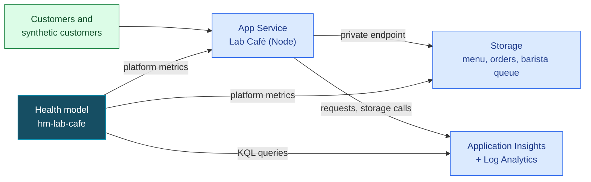
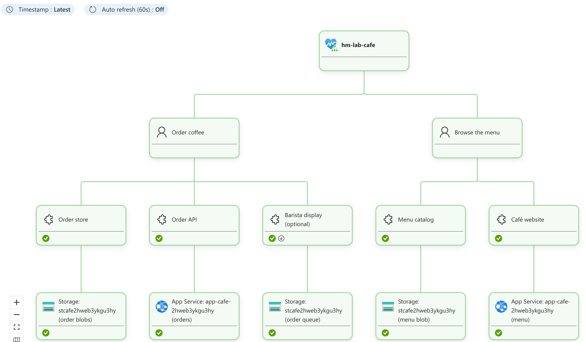
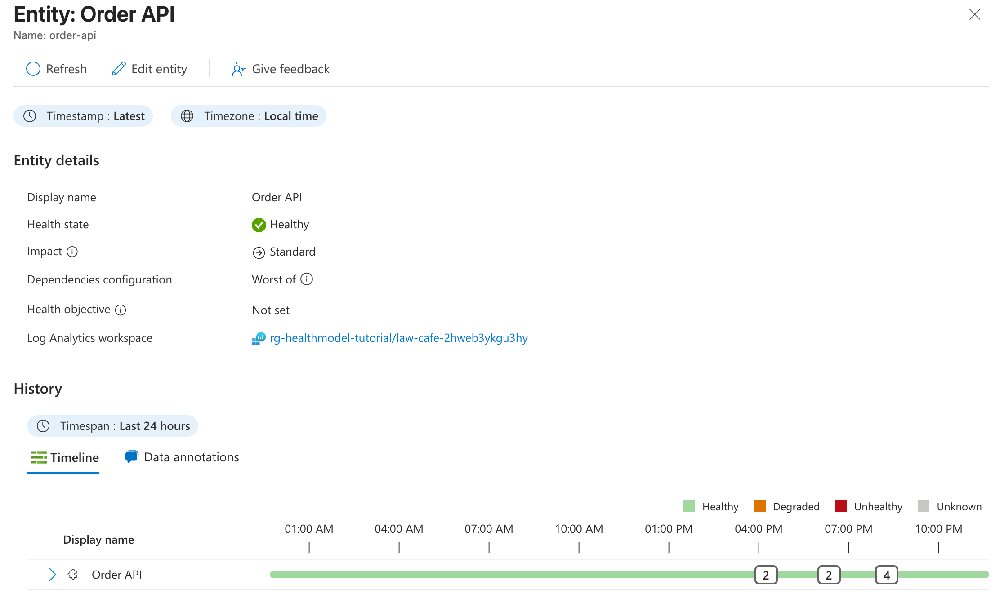
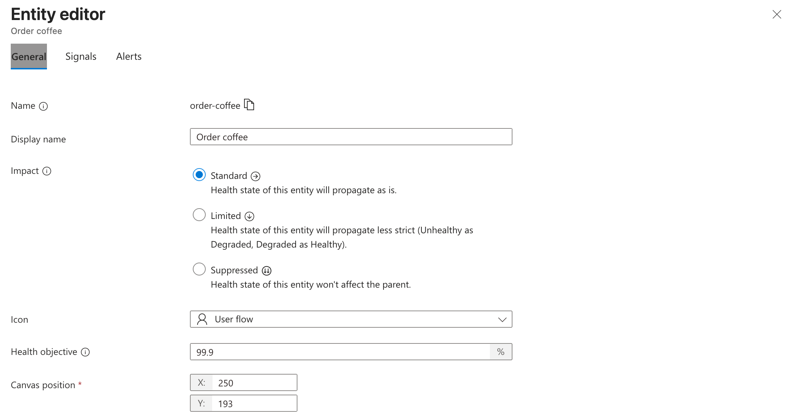
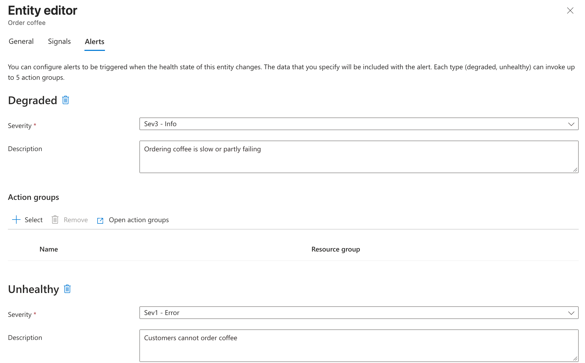
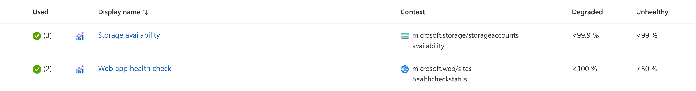
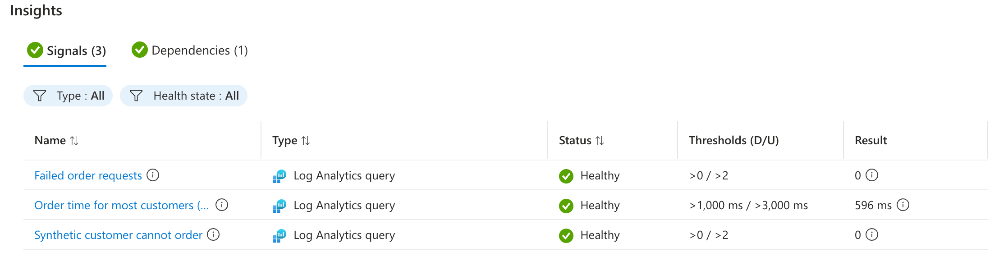
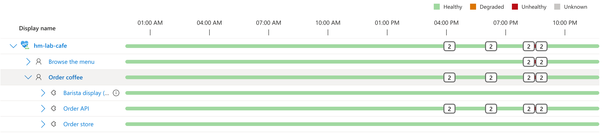

# Health Model Tutorial: Lab Café ☕🩺

In this tutorial you finally done it. You run your own coffee shop! In the cloud. 

But you will see that a lot can go wrong, but a health model help you have an overview of your café's health and the chance to drill down into the details.

If you're used to just alerts on some metrics, they can give you the full picture, they are just a signal that something is not right.

But once you give meaning to the signals, combine or route them, you can start to understand the impact of it. 

E.g. if you're CPU load is high, an alert might fire, but in the end, who cares that you're using your CPU a lot. If though your orders start to get delayed, it affects customers in your café.

**After this tutorial you can:**

1. Read a health model: user flows, system components and Azure resources.
2. Explain where an entity's state comes from: signals, thresholds and rollup.
3. Add a signal that still returns a number when nobody visits.
4. Predict how a failure rolls up, and use impact to say what matters to customers.

| | |
|---|---|
| ⏱️ Time | About 45 minutes, half of it waiting while you read, look around or predict |
| 💶 Cost | Roughly EUR 1-2 per day: App Service B1, two private endpoints, two availability tests, a little Log Analytics. Delete the resource group when you're done ([§6](#6-clean-up)) |
| 📍 Region | `swedencentral` by default, everything in its own resource group `rg-healthmodel-tutorial`. Other regions that offer health models work too (`-Location`) |
| 🧩 Standalone | You don't need the rest of the lab. Its own health models are in [scenario 45](DEMO-SCENARIOS.md#s45) |
| ✅ Last verified | 2026-11-05 with Azure CLI 2.92, `health-models` extension 1.0.0b2, API `2026-11-01` |

## Before you start

### Install the health models CLI

The health models CLI is the `health-models` extension for Azure CLI. Use PowerShell 7 (`pwsh`) on Windows, macOS or Linux, or Azure Cloud Shell switched to **PowerShell**.

1. [Install Azure CLI](https://learn.microsoft.com/cli/azure/install-azure-cli) 2.75 or later. Azure Cloud Shell already includes it. Check your version:

   ```powershell
   az version
   ```

2. Install the health models extension, then check that its commands are available:

   ```powershell
   az extension add --name health-models
   az monitor health-models --help
   ```

   The help output should list commands such as `create`, `show` and `entity`. See the [official CLI installation steps](https://learn.microsoft.com/azure/azure-monitor/health-models/cli#install-the-extension).

3. Sign in to Azure:

   ```powershell
   az login
   ```

### Permissions and repository setup

- Owner, or Contributor plus User Access Administrator, on the subscription or resource group. The scripts create role assignments for the app and for the health model.
- The health model resource provider registered on the subscription. The build script registers it if needed, which takes rights on the subscription; with rights on the resource group only, ask an admin to run `az provider register --namespace Microsoft.CloudHealth` once.
- Run everything from the repository root. Put your subscription in `.azure-target.json` (copy [.azure-target.json.template](../.azure-target.json.template)) or pass `-SubscriptionId` to every script.

## What you'll build



And this is the health model, in **Monitor → Health models → hm-lab-cafe → Graph**:



## Official documentation

This tutorial is for seeing and trying; the Microsoft Learn pages are the reference. Each section links the page that goes deeper.

| Topic | Microsoft Learn | Used in |
|---|---|---|
| What health models are | [Overview](https://learn.microsoft.com/azure/azure-monitor/health-models/overview), [concepts](https://learn.microsoft.com/azure/azure-monitor/health-models/concepts) | §1 |
| How to design one | [Health modeling with health models](https://learn.microsoft.com/azure/azure-monitor/health-models/health-modeling), [Well-Architected health modeling](https://learn.microsoft.com/azure/well-architected/design-guides/health-modeling) | §3 |
| Graph, timeline, entity details | [Analyze health state](https://learn.microsoft.com/azure/azure-monitor/health-models/analyze-health), [designer](https://learn.microsoft.com/azure/azure-monitor/health-models/designer) | §3, §5 |
| Alerts and health objectives | [Alerts](https://learn.microsoft.com/azure/azure-monitor/health-models/alerts), [health objective](https://learn.microsoft.com/azure/azure-monitor/health-models/concepts#health-objective) | §3 |
| Signals and signal definitions | [Signals](https://learn.microsoft.com/azure/azure-monitor/health-models/signals), [configure signals](https://learn.microsoft.com/azure/azure-monitor/health-models/tutorial-signals) | §3, §4 |
| Rollup and impact | [Configure health rollup](https://learn.microsoft.com/azure/azure-monitor/health-models/rollup) | §5 |
| Build with the CLI | [Create a health model with the Azure CLI](https://learn.microsoft.com/azure/azure-monitor/health-models/cli) | §4 |
| Questions | [FAQ](https://learn.microsoft.com/azure/azure-monitor/health-models/health-models-faq) | |

## 1. Four words to start with

Start the deploy in [§2](#2-open-the-café) first, then read this while it runs.

| Term | What it means at the café |
|---|---|
| **Entity** | Anything that has a health state: something customers do ("Order coffee"), a part of the system ("Order API") or an Azure resource ("App Service: app-cafe-..."). Every model has a **root** entity named like the model |
| **Signal** | Evidence for an entity: an Azure Monitor metric, a KQL query on Log Analytics, or a PromQL query. Each signal has a *degraded* and an *unhealthy* threshold |
| **Relationship** | "Parent depends on child". Health flows upward, from child to parent |
| **Health state** | 🟢 Healthy, 🟡 Degraded, 🔴 Unhealthy, ⚪ Unknown (no evidence, for example a query that returns nothing) |

The other terms (signal definition, rollup, impact, health objective) show up where you first see them. 📚 [Health model concepts](https://learn.microsoft.com/azure/azure-monitor/health-models/concepts)

## 2. Open the café

```powershell
./scripts/deploy-healthmodel-tutorial.ps1
./scripts/build-healthmodel-tutorial.ps1 -SkipFailedOrderSignal
```

The first script deploys the café ([infra/healthmodel-tutorial/workload.bicep](../infra/healthmodel-tutorial/workload.bicep)), publishes the app and places a test order (about 5 minutes). The second builds the health model with the `az monitor health-models` CLI (about 2 minutes). It leaves one signal out on purpose: you add it in §4.

The café is one Node file with no dependencies ([workloads/cafe/server.js](../workloads/cafe/server.js)):

| Route | What it does | What it touches |
|---|---|---|
| `GET /` and `GET /api/menu` | Shows the menu | Reads blob `menu/menu.json` |
| `POST /api/orders` | Places an order | Reads the menu, writes blob `orders/<id>.json`, then tells the barista display through a queue. If the queue fails, the order **still succeeds** |
| `GET /api/orders/<id>` | Looks up an order | Reads blob `orders/<id>.json` |
| `GET /healthz` | App Service health check | Nothing |

Application Insights records every request and every storage call. Two availability tests act as synthetic customers that open the menu and order a flat white every 5 minutes, so the model has data even at 3 a.m. Storage only accepts private traffic, through VNet integration and private endpoints, which gives us a realistic way to break things later.

> ✅ **Done when:** the printed URL opens the café, and **Monitor → Health models → hm-lab-cafe** shows the graph. Give it up to 15 minutes to turn green: the café's first requests can fail while it starts, and those stay in the signal windows for a while. Log signals can also say *insufficient access* for about 10 minutes while the model's role arrives. Wait; don't rerun the build or recreate entities, that deletes their history. Start §3 in the meantime.

## 3. Look around

Open **Monitor → Health models → hm-lab-cafe → Graph** (the picture under [What you'll build](#what-youll-build)). Read it top down:

- **User flows**: what customers come to do. *Browse the menu* and *Order coffee* have no signals of their own; they get their health from their children.
- **System components**: the parts each flow needs, named by what they do (*Order API*, *Order store*). Their signals are KQL queries on Application Insights that measure what customers feel: failed requests, slow orders, failed storage calls.
- **Azure resources**: the web app and storage account, with platform metrics (health check, storage availability). The same web app shows up twice, once under each flow. A health model is a tree, so each flow gets its own copy and every entity has exactly one parent.
- **Barista display (optional)**: a missing notification is annoying, not an outage. Its *impact*, how much it counts for its parent, is Limited: when it turns Unhealthy, *Order coffee* only turns Degraded. Keep it in mind for §5.

Select **Order API** to open its details. They show its state, the rollup rule (*Worst of*: a parent takes the worst state of its children; Unknown children don't count) and a 24-hour history:



Now select **Order coffee** and choose **Edit**. A user flow carries what the business cares about. The *General* tab holds the impact and the **health objective**, the share of time the flow should be Healthy. Only Unhealthy time counts against it; Degraded doesn't. 99.9% over 30 days allows about 43 minutes of Unhealthy time. The *Alerts* tab has one alert per state:

| General | Alerts |
|---|---|
|  |  |

Close the editor without saving. Last stop: **Signal definitions**. A signal definition is a signal you can reuse. Both App Service entities share the health check, all three storage entities share availability, and changing a definition changes every entity that uses it:



📚 [Analyze the health state](https://learn.microsoft.com/azure/azure-monitor/health-models/analyze-health), [alerts](https://learn.microsoft.com/azure/azure-monitor/health-models/alerts), [health objective](https://learn.microsoft.com/azure/azure-monitor/health-models/concepts#health-objective). Why the model looks like this: [docs/healthmodel/cafe/plan.md](healthmodel/cafe/plan.md).

## 4. Add one signal

*Order API* watches slow orders and the synthetic customer, but nothing counts orders that fail for real customers. Add that signal.

First try the query yourself in **Log Analytics workspace `law-cafe-…` → Logs**, time range *Last 5 minutes*, the same window the signal looks at:

```kusto
AppRequests
| where Url has "/api/orders"
| summarize value = countif(ResultCode startswith "5")
```

It returns one row, `value = 0` (more if the café is still starting). That's what a signal needs: one number, also when nobody orders. A query that returns no row, or a metric filtered to HTTP 500s that never happen, leaves the signal ⚪ Unknown, and an Unknown signal can't warn you. It counts only server errors (5xx): a 404 for a mistyped order ID is the customer's mistake, not an outage.

Now add it in the portal:

1. **hm-lab-cafe → Designer**, then **Edit** on **Order API**, then the **Signals** tab. Order API already reads from the workspace `law-cafe-…`, so you don't need to add a data source.
2. **Add log query signal** → **Create new**, and fill in:

   | Field | Value |
   |---|---|
   | Display name | Failed order requests |
   | Query | **Edit query**, paste the query above, time range 5 minutes (how far back it looks), **Run**, **Done** |
   | Value column name | `value` |
   | Data unit | Count |
   | Degraded threshold | greater than 0 |
   | Unhealthy threshold | greater than 2 |

3. **Add to entity**, then **Save**.

<details>
<summary><b>Or with the CLI</b></summary>

`az monitor health-models entity update` replaces a whole signal group, so this reads the entity, adds the signal (or replaces it, if it's already there) and writes it back:

```powershell
$model = az monitor health-models show -g rg-healthmodel-tutorial -n hm-lab-cafe --query id -o tsv
$url = "https://management.azure.com$model/entities/order-api?api-version=2026-11-01"
$entity = az rest --url $url -o json | ConvertFrom-Json
$group = $entity.properties.signalGroups.azureLogAnalytics
$group.signals = @($group.signals | Where-Object name -ne 'failed-order-requests') + @{
  name = 'failed-order-requests'; displayName = 'Failed order requests'; signalKind = 'LogAnalyticsQuery'
  queryText = 'AppRequests | where Url has "/api/orders" | summarize value = countif(ResultCode startswith "5")'
  valueColumnName = 'value'; timeGrain = 'PT5M'; refreshInterval = 'PT1M'; dataUnit = 'Count'
  evaluationRules = @{ degradedRule = @{ operator = 'GreaterThan'; threshold = 0 }; unhealthyRule = @{ operator = 'GreaterThan'; threshold = 2 } }
}
$file = New-TemporaryFile
$entity | ConvertTo-Json -Depth 20 | Set-Content $file
az rest --method put --url $url --body "@$file"
```

</details>

> ✅ **Done when:** within a few minutes the Order API's signal table shows *Failed order requests* at 0, Healthy:
>
> 

Don't run the build script again from here on: it replaces every entity, so your signal would be gone.

📚 [Configure signals](https://learn.microsoft.com/azure/azure-monitor/health-models/tutorial-signals). The [build script](../scripts/build-healthmodel-tutorial.ps1) creates every other signal, entity and relationship from one table; [Create a health model with the Azure CLI](https://learn.microsoft.com/azure/azure-monitor/health-models/cli) walks through the commands.

## 5. Break it: predict, then look 🔨

Each break changes one thing, then sends a few customers so failures show within minutes. Before you run one, write down your prediction:

> **My prediction:** these entities change, to these states: ... These stay Healthy: ... It recovers after about ... minutes.

Then break, watch the signals, compare and restore. Open the answer only after you've looked.

### Watch health and signal values

Signals refresh every minute after telemetry arrives. Failures count until they leave their query window.

Show entity health:

```powershell
az monitor health-models entity list -g rg-healthmodel-tutorial --health-model-name hm-lab-cafe `
  --query "[].{Entity:properties.displayName,Health:properties.healthState}" -o table
```

Select **Barista display (optional)** in the portal for values and thresholds, or inspect its signals:

```powershell
az monitor health-models entity show -g rg-healthmodel-tutorial --health-model-name hm-lab-cafe -n barista-display `
  --query "properties.signalGroups.azureLogAnalytics.signals[].{Signal:displayName,Value:status.value,Health:status.healthState,Window:timeGrain,Updated:status.reportedAt,Error:status.error}" -o table
```

Rerun every minute. **Updated** is the last evaluation; check **Error** before trusting values. For other experiments, replace `barista-display` with `order-api`, `cafe-website` or `menu-catalog`.

### 5.1 The optional barista

The barista queue gets deleted, so the barista display misses orders. Orders still go through. First see what happens *without* limited impact:

```powershell
az monitor health-models entity update -g rg-healthmodel-tutorial --health-model-name hm-lab-cafe -n barista-display --impact Standard
./scripts/break-healthmodel-tutorial.ps1 -Scenario BaristaQueue
```

Predict: what color does *Order coffee* turn? Look. Then switch the impact back and predict again:

```powershell
az monitor health-models entity update -g rg-healthmodel-tutorial --health-model-name hm-lab-cafe -n barista-display --impact Limited
```

<details>
<summary><b>Check your prediction</b></summary>

- With `Standard` impact: Barista display 🔴 Unhealthy, Order coffee 🔴 Unhealthy, Lab Café 🔴 Unhealthy. A missing notification looks like an outage.
- With `Limited` impact: Barista display stays 🔴 Unhealthy, but Order coffee and Lab Café drop to 🟡 Degraded. Browse the menu stays 🟢 Healthy throughout.
- Limited impact passes Unhealthy up as only Degraded, and Degraded time doesn't count against the health objective.

📚 [Impact in health rollup](https://learn.microsoft.com/azure/azure-monitor/health-models/rollup)

</details>

```powershell
./scripts/break-healthmodel-tutorial.ps1 -Scenario BaristaQueue -Restore
```

Watch the barista signal again after restoring. It counts failed notifications in the **last five minutes**, not failures since the café started. Successful notifications do not cancel earlier failures. The count falls to 0 as those failures leave the window, then the signal turns Healthy on a following evaluation. A burst can disappear all at once rather than count down one by one. Allow five minutes after the last failed notification, plus telemetry and evaluation delay.

Wait for this signal to reach 0 before the next experiment, so its remaining failures don't obscure the new result. A healthy queue-storage resource alone doesn't prove notifications have recovered.

### 5.2 A bad release

An app setting makes every order fail with HTTP 500, like a bad deploy. Predict: what happens to *Order API*, *Order coffee*, *Browse the menu* and the root? Which signal fires first?

```powershell
./scripts/break-healthmodel-tutorial.ps1 -Scenario BadRelease
```

<details>
<summary><b>Check your prediction</b></summary>

- Order API 🔴 Unhealthy. Your signal from §4 fires first, within about 2 minutes; the synthetic customer follows on its next run. Order coffee 🔴 Unhealthy and its Sev1 alert fires. Lab Café 🔴 Unhealthy.
- Browse the menu stays 🟢 Healthy: the Café website's signals only count menu requests. The web app is shared, but the failure is in the order code.
- Both App Service entities stay 🟢 Healthy: `/healthz` still answers.

</details>

```powershell
./scripts/break-healthmodel-tutorial.ps1 -Scenario BadRelease -Restore
```

Use the signal command above with `-n order-api` to watch recovery. Failed order requests look back five minutes; the synthetic customer and slow-order signals look back 15 minutes. They can keep Order API red after the failed request count reaches 0. Allow 15 minutes after the last bad result, plus telemetry and evaluation delay. Wait for Order API to recover before 5.3 if you want to distinguish the experiments in the graph.

### 5.3 A network change

The web app loses its VNet integration, so storage, which only accepts private traffic, turns it away. Predict: will the web app's health check turn red? Storage availability? The Order store? The barista display?

```powershell
./scripts/break-healthmodel-tutorial.ps1 -Scenario NetworkCut
```

<details>
<summary><b>Check your prediction</b></summary>

- Café website, Menu catalog and Order API 🔴 Unhealthy; Browse the menu, Order coffee and Lab Café 🔴 Unhealthy.
- Order store and Barista display stay 🟢 Healthy: every order fails at the menu lookup, before it gets that far.
- The App Service health checks and storage availability stay 🟢 Healthy too. `/healthz` doesn't touch storage, and requests turned away by the network don't count against storage availability.

</details>

If you clean up next ([§6](#6-clean-up)), skip the restore. Otherwise it redeploys the workload template (3 to 5 minutes), then old failures must leave the signal windows:

```powershell
./scripts/break-healthmodel-tutorial.ps1 -Scenario NetworkCut -Restore
```

Watch the signals on **Café website**, **Menu catalog** and **Order API**. Request and dependency counts look back five minutes; synthetic failures and order latency look back 15 minutes. Their windows can keep the flows red after storage access works again.

### Look back

Open **Timeline**. It shows every entity on one time axis; expand a row to see its children. The boxes mark state changes, and the number in a box is how many happened close together. Find your three breaks:



What the breaks teach:

- **A healthy resource doesn't mean a healthy flow.** During the network change, Azure reports the web app and storage as fine. Only the component signals, which measure what customers experience, catch it.
- **A component only sees what reaches it.** Read the whole tree, not just the reddest box.
- **Impact is a business decision.** The same failure is an outage or a nuisance, depending on one setting you choose.

📚 [Analyze the health state](https://learn.microsoft.com/azure/azure-monitor/health-models/analyze-health)

## 6. Clean up

```powershell
az group delete -n rg-healthmodel-tutorial --yes
```

## Where to go next

- **Build a model yourself:** the official quickstarts for the [portal](https://learn.microsoft.com/azure/azure-monitor/health-models/create), [Bicep](https://learn.microsoft.com/azure/azure-monitor/health-models/tutorial-bicep) and the [CLI](https://learn.microsoft.com/azure/azure-monitor/health-models/quickstart-cli).
- **Design one for your app:** [health modeling in the Well-Architected Framework](https://learn.microsoft.com/azure/well-architected/design-guides/health-modeling). Using an AI coding agent? The `healthmodel-plan` skill writes a plan like [the café's](healthmodel/cafe/plan.md) from your code and IaC.
- **Grow a model without hand work:** [discovery rules](https://learn.microsoft.com/azure/azure-monitor/health-models/discoveries) add entities for resources that match a query.
- **Everything else:** the [official documentation table](#official-documentation) above.
