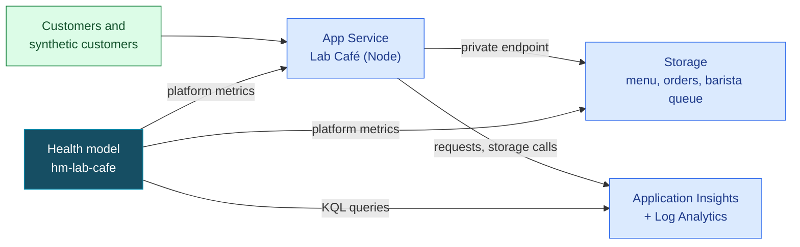
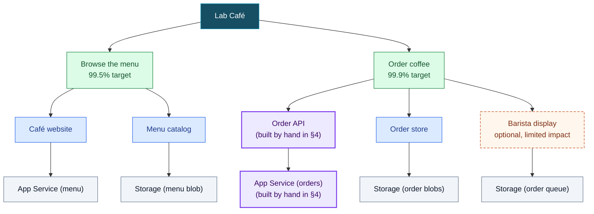
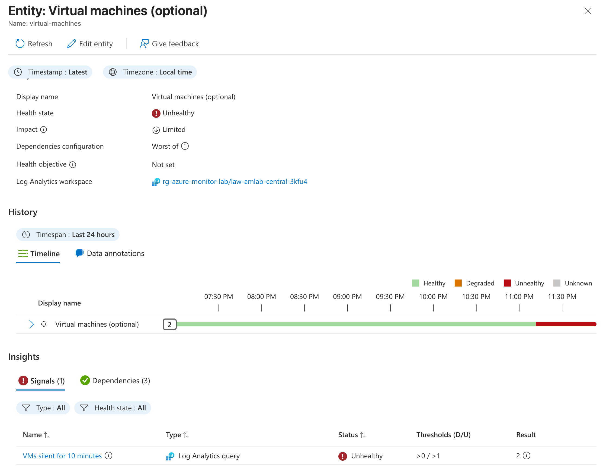

# Health Model Tutorial: Lab Café ☕🩺

Alerts tell you *a metric crossed a line*. A health model tells you *whether your customers can do what they came for*. In this tutorial you open a tiny coffee shop on Azure, design its health model from what customers do (user flows first, Azure resources last), build it with the `az monitor health-models` CLI, and then break the café on purpose to check your predictions against the model.

**After this tutorial you can:**

1. Derive user flows, system components and Azure resources from an app's code.
2. Pick signals that return a number even when nobody visits, and put them on the right layer.
3. Build a health model with the `az monitor health-models` CLI.
4. Predict how a failure rolls up, then check the prediction against the model.
5. Use impact and health objectives to say what matters to customers.

| | |
|---|---|
| ⏱️ Time | **Short path** about 60 minutes (build, one break). **Full path** about 2 hours (four experiments). Much of it is waiting, and every wait has a task |
| 💶 Cost | Roughly EUR 1-2 per day: App Service B1, two private endpoints, two availability tests, a little Log Analytics. Delete the resource group when you're done ([§9](#9-clean-up)) |
| 📍 Region | `swedencentral` by default, everything in its own resource group `rg-healthmodel-tutorial`. Other regions that offer health models work too (`-Location`) |
| 🧩 Standalone | You don't need the rest of the lab. The lab's demo model ([scenario 45](DEMO-SCENARIOS.md#s45)) groups by Azure resource tier; this tutorial teaches the user-flow approach, and the [lab's own user-flow model](healthmodel/lab/plan.md) shows it applied to the full lab |
| ✅ Last verified | 2026-11-04 with Azure CLI 2.92, `health-models` extension 1.0.0b2, API `2026-11-01` |

**Your route**

| Step | Short path | Full path | While you wait |
|---|---|---|---|
| [2. Open the café](#2-open-the-café) | ✅ | ✅ | Read the café code |
| [3. Design it yourself](#3-design-it-yourself-first) | ✅ | ✅ | |
| [4. Build one branch by hand](#4-build-the-order-coffee-branch-by-hand) | Skip to 4.8 | ✅ | Compare your design with the answer key |
| [5. Watch it go green](#5-watch-it-go-green) | ✅ | ✅ | Run a signal's query yourself |
| [6. Break it](#6-break-it-predict-then-look-) | 6.2 only | 6.1 to 6.4 | Write the next prediction |
| [7. Bonus](#7-bonus-moves), [8. Take it home](#8-take-it-home) | 8 | ✅ | |

## What you'll build



And this is the model you'll end up with, in **Monitor → Health models → hm-lab-cafe → Graph**:


## Official documentation

This tutorial is hands-on; the Microsoft Learn pages are the reference. Each section links the page that goes deeper.

| Topic | Microsoft Learn | Used in |
|---|---|---|
| What health models are | [Overview](https://learn.microsoft.com/azure/azure-monitor/health-models/overview), [concepts](https://learn.microsoft.com/azure/azure-monitor/health-models/concepts) | §1 |
| How to design one | [Health modeling with health models](https://learn.microsoft.com/azure/azure-monitor/health-models/health-modeling), [Well-Architected health modeling](https://learn.microsoft.com/azure/well-architected/design-guides/health-modeling) | §3 |
| Build with the CLI | [Create a health model with the Azure CLI](https://learn.microsoft.com/azure/azure-monitor/health-models/cli), the tutorial this one builds on | §4 |
| Signals and signal definitions | [Signals](https://learn.microsoft.com/azure/azure-monitor/health-models/signals), [configure signals](https://learn.microsoft.com/azure/azure-monitor/health-models/tutorial-signals) | §4.4, §4.5 |
| Rollup and impact | [Configure health rollup](https://learn.microsoft.com/azure/azure-monitor/health-models/rollup) | §4.7, §6.1 |
| Alerts and health objectives | [Alerts](https://learn.microsoft.com/azure/azure-monitor/health-models/alerts), [health objective](https://learn.microsoft.com/azure/azure-monitor/health-models/concepts#health-objective) | §4.6 |
| Graph, timeline, entity details | [Analyze health state](https://learn.microsoft.com/azure/azure-monitor/health-models/analyze-health), [designer](https://learn.microsoft.com/azure/azure-monitor/health-models/designer) | §5 |
| Annotations and external reports | [Data annotations](https://learn.microsoft.com/azure/azure-monitor/health-models/data-annotations), [health report ingestion](https://learn.microsoft.com/azure/azure-monitor/health-models/health-report-ingestion) | §7 |
| Questions | [FAQ](https://learn.microsoft.com/azure/azure-monitor/health-models/health-models-faq) | |

## Before you start

- Azure CLI 2.75 or later, signed in with `az login`.
- The health models CLI extension (preview, tested with 1.0.0b2): `az extension add --name health-models`.
- PowerShell 7 (`pwsh`) on Windows, macOS or Linux, or Azure Cloud Shell switched to **PowerShell**. The scripts need it. Prefer Bash? Section 4 has a Bash version of every command; use the scripts for the rest.
- Owner, or Contributor plus User Access Administrator, on the subscription or resource group. The scripts create role assignments for the app and for the health model.
- The health model resource provider, once per subscription: `az provider register --namespace Microsoft.CloudHealth --wait` (the build script does this too).
- Run everything from the repository root. Put your subscription in `.azure-target.json` (copy [.azure-target.json.template](../.azure-target.json.template)) or pass `-SubscriptionId` to every script.

## 1. Four words to start with

| Term | What it means at the café |
|---|---|
| **Entity** | Anything that has a health state: something customers do ("Order coffee"), a part of the system ("Order API") or an Azure resource ("App Service: app-cafe-..."). Every model has a **root** entity named like the model |
| **Signal** | Evidence for an entity: an Azure Monitor metric, a KQL query on Log Analytics, or a PromQL query. Each signal has a *degraded* and an *unhealthy* threshold |
| **Relationship** | "Parent depends on child". Health flows upward, from child to parent |
| **Health state** | 🟢 Healthy, 🟡 Degraded, 🔴 Unhealthy, ⚪ Unknown (no evidence, for example a query that returns nothing) |

The other terms (signal definition, rollup, impact, health objective) show up where you first need them. 📚 [Health model concepts](https://learn.microsoft.com/azure/azure-monitor/health-models/concepts)

## 2. Open the café

The café is one Node file with no dependencies ([workloads/cafe/server.js](../workloads/cafe/server.js)). Application Insights records every request and every storage call automatically. Two availability tests act as synthetic customers that open the menu and order a flat white every 5 minutes, so the model always has data, even at 3 a.m.

```powershell
./scripts/deploy-healthmodel-tutorial.ps1
```

The script deploys [infra/healthmodel-tutorial/workload.bicep](../infra/healthmodel-tutorial/workload.bicep), publishes the app and places a test order (about 5 minutes):

```text
==> Waiting for the café to open its doors
    Menu: Espresso, Flat white, Oat latte, Cold brew
    Test order 1f0c...: oat-latte, brewing

☕ Lab Café is open at https://app-cafe-<suffix>.azurewebsites.net
```

Storage only accepts private traffic: the web app reaches it through VNet integration and private endpoints. Many enterprise subscriptions enforce this by policy, and it gives us a realistic way to break things later.

> ✅ **Done when:** you can open the printed URL, order a drink with one of the buttons, and find your order a few minutes later in **Log Analytics workspace `law-cafe-…` → Logs** (Application Insights' own Logs page uses the older `requests` table names):
>
> ```kusto
> AppRequests | where Url has "/api/orders" | project TimeGenerated, ResultCode, DurationMs | order by TimeGenerated desc
> ```

## 3. Design it yourself first

Before you look at any answer, spend 10 minutes with paper or a whiteboard. Here is everything the café does:

| Route | What it does | What it touches |
|---|---|---|
| `GET /` and `GET /api/menu` | Shows the menu | Reads blob `menu/menu.json` |
| `POST /api/orders` | Places an order | Reads the menu, writes blob `orders/<id>.json`, then sends a message to the barista queue. If that message fails, the order **still succeeds** (see the `try/catch` around `notifyBarista`) |
| `GET /api/orders/<id>` | Looks up an order | Reads blob `orders/<id>.json` |
| `GET /healthz` | App Service health check | Nothing |

Sketch three layers:

1. **User flows**: what do customers come to do? (Hint: two things. Placing and looking up an order are one job.)
2. **System components**: for each flow, which parts must work? Name them by what they do, not by the Azure service.
3. **Azure resources**: which resource sits under each part?

Then answer:

- Which part is optional, and what should happen to its flow when it fails?
- For one part, which number would tell you it's hurting customers? Which table holds it? When is it degraded, when unhealthy?
- Which of your signals would show *nothing* at 3 a.m. when nobody orders?

<details>
<summary><b>Answer key</b> (open after you've sketched yours)</summary>



Purple boxes, plus *Order coffee* and the root, are what you build by hand in §4; the script adds the rest.

Compare with yours, one line per difference. Most designs differ in these places:

- **A tree, not a web.** Each entity has one parent, so the shared web app and storage account appear once under *each* flow. Those copies keep the tree readable and let each carry its own thresholds. What actually stops a broken order endpoint from turning browsing red is the component signals: they count only their own flow's requests. If the web app itself fails, both flows show it, as they should.
- **Measure what customers feel on the components** (failed requests, slow orders, failed storage calls, as KQL on Application Insights) and keep **platform metrics on the resources** (health check, storage availability).
- **Signals must return a number when it's quiet.** `countif(Success == false)` returns 0 without traffic. A p95 latency returns null, so the order-time signal wraps it: `summarize p95 = percentile(DurationMs, 95) | project value = coalesce(p95, 0.0)`. A metric filtered to HTTP 500s returns *nothing* and leaves its entity Unknown. And a failure count of 0 at 3 a.m. proves nothing, which is why each flow also has a synthetic customer signal.
- **Optional parts get limited impact.** *Impact* says how much a child counts for its parent. `Limited` passes Unhealthy up as only Degraded: the barista missing an order is annoying, not an outage.

The full answer key with every signal, threshold and failure scenario is [docs/healthmodel/cafe/plan.md](healthmodel/cafe/plan.md). The build script implements [modelspec.md](healthmodel/cafe/modelspec.md), the engineering record behind it (no need to read it now).

</details>

📚 [Health modeling with Azure Monitor health models](https://learn.microsoft.com/azure/azure-monitor/health-models/health-modeling)

> 🤖 Using an AI coding agent? The `healthmodel-plan` skill produces a plan and modelspec like these from your code and IaC, and `healthmodel-build` verifies every signal against live data before deploying.

## 4. Build the *Order coffee* branch by hand

You'll build four entities (root, *Order coffee*, *Order API*, *App Service (orders)*), bottom up, so the first thing that can turn green is a fast platform metric. Set a few variables (run this block again if you open a new terminal):

```powershell
$rg = 'rg-healthmodel-tutorial'
$model = 'hm-lab-cafe'
$outputs = az deployment group show -g $rg -n healthmodel-tutorial-workload --query properties.outputs -o json | ConvertFrom-Json
$appId = $outputs.webAppId.value
$workspaceId = $outputs.logAnalyticsWorkspaceId.value
$work = New-Item -ItemType Directory -Force (Join-Path ([IO.Path]::GetTempPath()) 'hm-lab-cafe')
```

Short path? Run that block, then skip to [4.8](#48-build-the-rest).

The CLI takes JSON with kebab-case keys. The commands below write it to small files in `$work`, which avoids quoting trouble.

### 4.1 Create the model with its own identity

The model reads metrics and logs with a managed identity, not with your account.

```powershell
az monitor health-models create -g $rg -n $model -l swedencentral --mi-system-assigned
```

📚 [Create a health model with the Azure CLI](https://learn.microsoft.com/azure/azure-monitor/health-models/cli)

### 4.2 Let the identity read

Azure grants the model nothing by default. *Monitoring Reader* on the resource group covers both metrics and Log Analytics queries:

```powershell
$principalId = az monitor health-models show -g $rg -n $model --query identity.principalId -o tsv
az role assignment create --assignee-object-id $principalId --assignee-principal-type ServicePrincipal `
  --role 'Monitoring Reader' --scope (az group show -n $rg --query id -o tsv)
```

⏳ Metric signals pick this up within minutes, Log Analytics signals take about 10. Use the time to compare your design with the answer key in §3.

### 4.3 Tell signals which identity to use

```powershell
az monitor health-models authentication-setting create -g $rg --health-model-name $model -n auth-system `
  --managed-identity managed-identity-name=SystemAssigned
```

### 4.4 Azure resource: the web app, with a reusable signal

A **signal definition** is a signal you can reuse: both App Service entities share this one, and changing it changes both. It reads the web app's built-in health check, which calls `/healthz` every minute:

```powershell
@{ 'metric-namespace' = 'Microsoft.Web/sites'; 'metric-name' = 'HealthCheckStatus'; 'aggregation-type' = 'Average'; 'time-grain' = 'PT5M' } |
  ConvertTo-Json | Set-Content "$work/metric.json"
@{ 'degraded-rule' = @{ operator = 'LessThan'; threshold = 100 }; 'unhealthy-rule' = @{ operator = 'LessThan'; threshold = 50 } } |
  ConvertTo-Json | Set-Content "$work/rules.json"

az monitor health-models signal-definition create -g $rg --health-model-name $model -n sd-app-health-check `
  --display-name 'Web app health check' --data-unit Percent --refresh-interval PT1M `
  --azure-resource-metric "@$work/metric.json" --evaluation-rules "@$work/rules.json"
```

Now the resource entity that uses it:

```powershell
@{
  'azure-resource' = @{
    'authentication-setting' = 'auth-system'; 'azure-resource-id' = $appId
    signals = @(@{ name = 'app-health-check'; 'signal-definition-name' = 'sd-app-health-check' })
  }
} | ConvertTo-Json -Depth 10 | Set-Content "$work/order-app.json"

az monitor health-models entity create -g $rg --health-model-name $model -n order-app `
  --display-name "App Service: $($outputs.webAppName.value) (orders)" --signal-groups "@$work/order-app.json"
```

Deleting an entity or a signal deletes its history. That's why flows and components, which live as long as the app, sit above the resources, which come and go.

Once the build script has run (§4.8), the model has two signal definitions, each reused by several resource entities. The portal shows how often each is used and its thresholds:


📚 [Signals in health models](https://learn.microsoft.com/azure/azure-monitor/health-models/signals)

### 4.5 System component: the Order API, with a KQL signal

The query runs on the workspace behind Application Insights and returns one row with one number, `value`. It counts server errors (5xx) on order requests, and returns 0 when there are none. A 404 for a mistyped order ID is the customer's mistake, not an outage:

```powershell
@{
  'azure-log-analytics' = @{
    'authentication-setting' = 'auth-system'
    'log-analytics-workspace-resource-id' = $workspaceId
    signals = @(@{
      name = 'failed-order-requests'; 'display-name' = 'Failed order requests'
      'query-text' = 'AppRequests | where Url has "/api/orders" | summarize value = countif(ResultCode startswith "5")'
      'value-column-name' = 'value'; 'time-grain' = 'PT5M'; 'data-unit' = 'Count'
      'evaluation-rules' = @{ 'degraded-rule' = @{ operator = 'GreaterThan'; threshold = 0 }; 'unhealthy-rule' = @{ operator = 'GreaterThan'; threshold = 2 } }
    })
  }
} | ConvertTo-Json -Depth 10 | Set-Content "$work/order-api.json"

az monitor health-models entity create -g $rg --health-model-name $model -n order-api `
  --display-name 'Order API' --icon icon-name=SystemComponent --signal-groups "@$work/order-api.json"
```

`time-grain` is the window the query looks back over: here, failures in the last 5 minutes. 📚 [Configure signals](https://learn.microsoft.com/azure/azure-monitor/health-models/tutorial-signals)

### 4.6 User flow: Order coffee, with a health objective and alerts

A user flow has no signals of its own; it gets its health from its children. It carries what the business cares about: the alerts, and a **health objective**, the share of time it should be Healthy. Only Unhealthy time counts against it; Degraded doesn't. 99.9% over 30 days allows about 43 minutes of Unhealthy time, so one 20-minute outage uses half of it. (You won't see the objective move today; it needs days of history.)

```powershell
@{ degraded = @{ severity = 'Sev3'; description = 'Ordering coffee is slow or partly failing' }
   unhealthy = @{ severity = 'Sev1'; description = 'Customers cannot order coffee' } } |
  ConvertTo-Json | Set-Content "$work/alerts.json"

az monitor health-models entity create -g $rg --health-model-name $model -n order-coffee `
  --display-name 'Order coffee' --icon icon-name=UserFlow --health-objective 99.9 --alerts "@$work/alerts.json"
```

In the portal, **Designer → Order coffee → Edit** shows the same settings. The *General* tab holds impact and the health objective, the *Alerts* tab one alert per state:

| General | Alerts |
|---|---|
|  |  |

📚 [Alerts in health models](https://learn.microsoft.com/azure/azure-monitor/health-models/alerts), [health objective](https://learn.microsoft.com/azure/azure-monitor/health-models/concepts#health-objective)

### 4.7 Wire them up

`--parent-entity-name` is the one that *depends on* `--child-entity-name`; health flows from child to parent. Swapping them is the most common mistake. The root entity already exists and is named like the model:

```powershell
foreach ($edge in @(@($model, 'order-coffee'), @('order-coffee', 'order-api'), @('order-api', 'order-app'))) {
  az monitor health-models relationship create -g $rg --health-model-name $model -n "$($edge[0])--$($edge[1])" `
    --parent-entity-name $edge[0] --child-entity-name $edge[1]
}
```

Each parent takes the **worst** state of its children by default (the *rollup*). Unknown children don't count, so a parent can be green while a child has no evidence yet. 📚 [Configure health rollup](https://learn.microsoft.com/azure/azure-monitor/health-models/rollup)

> ✅ **Done when:** this shows the root, `order-coffee`, `order-api` and `order-app`, and within about 5 minutes `order-app` is Healthy:
>
> ```powershell
> az monitor health-models entity list -g $rg --health-model-name $model --query "[].{entity:name, state:properties.healthState}" -o table
> ```
>
> `order-api` may say *insufficient access* for up to 10 minutes. That's the role from 4.2 still arriving. Don't recreate the entity; that would delete its history.

<details>
<summary><b>Bash version of 4.1 to 4.7</b></summary>

```bash
rg=rg-healthmodel-tutorial
model=hm-lab-cafe
out() { az deployment group show -g $rg -n healthmodel-tutorial-workload --query "properties.outputs.$1.value" -o tsv; }
appId=$(out webAppId); appName=$(out webAppName); workspaceId=$(out logAnalyticsWorkspaceId)
work=$(mktemp -d)

# 4.1 to 4.3
az monitor health-models create -g $rg -n $model -l swedencentral --mi-system-assigned
principalId=$(az monitor health-models show -g $rg -n $model --query identity.principalId -o tsv)
az role assignment create --assignee-object-id "$principalId" --assignee-principal-type ServicePrincipal \
  --role "Monitoring Reader" --scope "$(az group show -n $rg --query id -o tsv)"
az monitor health-models authentication-setting create -g $rg --health-model-name $model -n auth-system \
  --managed-identity managed-identity-name=SystemAssigned

# 4.4
jq -n '{"metric-namespace":"Microsoft.Web/sites","metric-name":"HealthCheckStatus","aggregation-type":"Average","time-grain":"PT5M"}' > "$work/metric.json"
jq -n '{"degraded-rule":{operator:"LessThan",threshold:100},"unhealthy-rule":{operator:"LessThan",threshold:50}}' > "$work/rules.json"
az monitor health-models signal-definition create -g $rg --health-model-name $model -n sd-app-health-check \
  --display-name "Web app health check" --data-unit Percent --refresh-interval PT1M \
  --azure-resource-metric "@$work/metric.json" --evaluation-rules "@$work/rules.json"
jq -n --arg id "$appId" '{"azure-resource":{"authentication-setting":"auth-system","azure-resource-id":$id,
  signals:[{name:"app-health-check","signal-definition-name":"sd-app-health-check"}]}}' > "$work/order-app.json"
az monitor health-models entity create -g $rg --health-model-name $model -n order-app \
  --display-name "App Service: $appName (orders)" --signal-groups "@$work/order-app.json"

# 4.5
jq -n --arg ws "$workspaceId" '{"azure-log-analytics":{"authentication-setting":"auth-system","log-analytics-workspace-resource-id":$ws,
  signals:[{name:"failed-order-requests","display-name":"Failed order requests",
    "query-text":"AppRequests | where Url has \"/api/orders\" | summarize value = countif(ResultCode startswith \"5\")",
    "value-column-name":"value","time-grain":"PT5M","data-unit":"Count",
    "evaluation-rules":{"degraded-rule":{operator:"GreaterThan",threshold:0},"unhealthy-rule":{operator:"GreaterThan",threshold:2}}}]}}' > "$work/order-api.json"
az monitor health-models entity create -g $rg --health-model-name $model -n order-api \
  --display-name "Order API" --icon icon-name=SystemComponent --signal-groups "@$work/order-api.json"

# 4.6
jq -n '{degraded:{severity:"Sev3",description:"Ordering coffee is slow or partly failing"},
  unhealthy:{severity:"Sev1",description:"Customers cannot order coffee"}}' > "$work/alerts.json"
az monitor health-models entity create -g $rg --health-model-name $model -n order-coffee \
  --display-name "Order coffee" --icon icon-name=UserFlow --health-objective 99.9 --alerts "@$work/alerts.json"

# 4.7
for edge in "$model order-coffee" "order-coffee order-api" "order-api order-app"; do
  read -r parent child <<< "$edge"
  az monitor health-models relationship create -g $rg --health-model-name $model -n "$parent--$child" \
    --parent-entity-name "$parent" --child-entity-name "$child"
done
```

</details>

### 4.8 Build the rest

You've seen every building block. The build script runs the same commands from one table in [scripts/build-healthmodel-tutorial.ps1](../scripts/build-healthmodel-tutorial.ps1): 2 signal definitions, 13 entities, 12 relationships. Every command is create-or-replace, so it replaces your hand-made branch with the script's version: *Order API* gains two more signals (order time and the synthetic customer), and anything you changed by hand is undone. The table in the script is the source of truth.

```powershell
./scripts/build-healthmodel-tutorial.ps1
```

Without `-ActionGroupId <action group resource ID>`, the user flow alerts fire in Azure Monitor but notify nobody.

## 5. Watch it go green

Rolled-up state of all entities:

```powershell
az monitor health-models entity list -g $rg --health-model-name $model `
  --query "[].{entity:name, name:properties.displayName, state:properties.healthState}" -o table
```

Every signal on one entity, with its current value:

```powershell
az monitor health-models entity show -g $rg --health-model-name $model -n order-api `
  --query "properties.signalGroups.*.signals[].{signal:name, state:status.healthState, value:status.value}" -o table
```

How a signal moved over time:

```powershell
az monitor health-models entity get-signal-history -g $rg --health-model-name $model `
  --entity-name order-api --signal-name failed-order-requests `
  --query "history[].{time:occurredAt, state:healthState, value:value}" -o table
```

### The same in the portal

Open **Monitor → Health models → hm-lab-cafe**. Under *Health*:

- **Graph** draws the tree with each entity's state (the picture under [What you'll build](#what-youll-build)). Select an entity to open its details.
- **Entity details** show the state, impact, rollup rule and objective, the state history, and every signal with its thresholds and current value. The table at the bottom is the portal version of the `entity show` command above:

  

  

- **Timeline** shows the history of every entity on one time axis; expand a row to see its children. The numbered boxes mark state changes:

  

📚 [Analyze the health state](https://learn.microsoft.com/azure/azure-monitor/health-models/analyze-health), [designer](https://learn.microsoft.com/azure/azure-monitor/health-models/designer)

> ✅ **Done when:** all 13 entities show Healthy. Give it up to 15 minutes after the build: the café's first requests can fail while it starts, and those failures stay in the 15-minute window of the synthetic customer signals.

⏳ **While you wait:** copy the `failed-order-requests` query into **Log Analytics workspace `law-cafe-…` → Logs**, set the time range to the last 5 minutes, and compare the result with the `value` column above. That's exactly what the model runs every minute.

**If it's not green**

| You see | Why | Do |
|---|---|---|
| Log signals Unknown with *insufficient access* | The **model's** identity is still getting its role (about 10 minutes). It's not the app's identity | Wait. Don't recreate the entity |
| All signals Unknown, also metrics | The model can't read at all | Check 4.2 and 4.3: `az role assignment list --assignee <principalId> --all -o table` and `az monitor health-models authentication-setting list -g $rg --health-model-name $model -o table` |
| One log signal Unknown, no error | The query returned no row or null | Run it in Logs; make it return 0 (`countif`, `coalesce`) |
| Red right after deploy or after a restore | Old failures still inside the signal's window | Wait up to 15 minutes |
| No rows in `AppRequests` at all | Telemetry is 2 to 5 minutes behind, or the app isn't sending | Wait, then check the app setting `APPLICATIONINSIGHTS_CONNECTION_STRING` |
| `MissingSubscriptionRegistration` | The provider isn't registered | `az provider register --namespace Microsoft.CloudHealth --wait` |

## 6. Break it: predict, then look 🔨

Each experiment changes one thing, then sends a few customers so failures show within minutes. Before you run one, write down your prediction:

> **My prediction:** these entities change, to these states: ... These stay Healthy: ... It recovers after about ... minutes.

Then break, wait about 5 minutes, check `entity list` or the portal graph, compare, restore, and wait until everything is green again before the next experiment. Open the answer only after you've looked.

### 6.1 The optional barista (full path)

The barista queue gets deleted, so the barista display misses orders. Orders still go through. First see what happens *without* limited impact, so you can tell impact from rollup:

```powershell
az monitor health-models entity update -g $rg --health-model-name $model -n barista-display --impact Standard
./scripts/break-healthmodel-tutorial.ps1 -Scenario BaristaQueue
```

Predict: what color does *Order coffee* turn? Look. Then switch the impact back and predict again:

```powershell
az monitor health-models entity update -g $rg --health-model-name $model -n barista-display --impact Limited
```

<details>
<summary><b>Check your prediction</b></summary>

- With `Standard` impact: Barista display 🔴 Unhealthy, Order coffee 🔴 Unhealthy, Lab Café 🔴 Unhealthy. A missing notification looks like an outage.
- With `Limited` impact: Barista display stays 🔴 Unhealthy, but Order coffee and Lab Café drop to 🟡 Degraded. Browse the menu stays 🟢 Healthy throughout.
- Recovery is quick (about 5 minutes): only a 5-minute signal saw the failure; the synthetic customer kept getting its orders through.

📚 [Impact in health rollup](https://learn.microsoft.com/azure/azure-monitor/health-models/rollup)

</details>

```powershell
./scripts/break-healthmodel-tutorial.ps1 -Scenario BaristaQueue -Restore
```

### 6.2 A bad release (short and full path)

An app setting makes every order fail with HTTP 500, like a bad deploy. Predict: what happens to *Order API*, *Order coffee*, *Browse the menu* and the root? Which signals fire first?

```powershell
./scripts/break-healthmodel-tutorial.ps1 -Scenario BadRelease
```

<details>
<summary><b>Check your prediction</b></summary>

- Order API 🔴 Unhealthy (failed order requests within about 2 minutes, then the synthetic order failures), Order coffee 🔴 Unhealthy, Lab Café 🔴 Unhealthy.
- Browse the menu stays 🟢 Healthy: the Café website's signals only count menu requests. The web app is shared, but the failure is in the order code.
- Both App Service entities stay 🟢 Healthy: `/healthz` still answers.
- Recovery takes up to 15 minutes after restore, because the synthetic order signal looks back 15 minutes.

</details>

```powershell
./scripts/break-healthmodel-tutorial.ps1 -Scenario BadRelease -Restore
```

Then ask the model what happened:

```powershell
az monitor health-models entity get-history -g $rg --health-model-name $model --entity-name order-coffee `
  --query "history[].{time:occurredAt, from:previousState, to:newState}" -o table
```

Did Order coffee go straight to Unhealthy or pass through Degraded? Which signal was faster, and why?

### 6.3 A network change (full path)

The web app loses its VNet integration, so storage, which only accepts private traffic, turns it away. Predict: will the web app's health check turn red? Storage availability? The Order store? The barista display?

```powershell
./scripts/break-healthmodel-tutorial.ps1 -Scenario NetworkCut
```

<details>
<summary><b>Check your prediction</b></summary>

- Café website, Menu catalog and Order API 🔴 Unhealthy; Browse the menu, Order coffee and Lab Café 🔴 Unhealthy.
- Order store and Barista display stay 🟢 Healthy: every order fails at the menu lookup, before it gets that far.
- The App Service health checks and storage availability stay 🟢 Healthy too. `/healthz` doesn't touch storage, and requests turned away by the network don't count against storage availability.

</details>

The restore redeploys the workload template (3 to 5 minutes), then the 15-minute windows have to drain:

```powershell
./scripts/break-healthmodel-tutorial.ps1 -Scenario NetworkCut -Restore
```

### 6.4 Silence (full path)

Stop the web app. Nobody gets an error page logged by the app, because there is no app. Predict: which signals notice, and which stay green?

```powershell
az webapp stop -g $rg -n $outputs.webAppName.value
```

<details>
<summary><b>Check your prediction</b></summary>

- The failed-request counts stay at 0 and green: no requests reach the app, so nothing fails *in* it.
- The synthetic customer signals turn red: the availability tests can't get a menu or place an order. They're what turns silence into an outage.
- The App Service health check stops reporting, so the App Service entities go ⚪ Unknown, not red.
- Storage availability goes ⚪ Unknown too: no requests reach storage, so the metric has no data points. Some platform metrics only exist while there's traffic.

</details>

```powershell
az webapp start -g $rg -n $outputs.webAppName.value
```

### What the breaks teach

- **A healthy resource doesn't mean a healthy flow.** During the network change, Azure reports the web app and storage as fine. Only the component signals, which measure what customers experience, catch it.
- **A component only sees what reaches it.** Read the whole tree, not just the reddest box.
- **Silence isn't health.** A failure count needs traffic to mean anything. Synthetic customers give it that traffic.
- **Impact is a business decision.** The same failure is an outage or a nuisance, depending on one setting you choose.

## 7. Bonus moves

Mark a deployment on the timeline, so the next person sees *why* health changed:

```powershell
az monitor health-models entity add-data-annotation -g $rg --health-model-name $model --entity-name order-coffee `
  --annotation-details "{release:v1.1,changedBy:tutorial}" --description 'Rolled out the new order code'
```

The annotation shows on the entity's *Data annotations* tab, next to its timeline. 📚 [Data annotations](https://learn.microsoft.com/azure/azure-monitor/health-models/data-annotations)

Report health from outside Azure Monitor, for example from a smoke test in your pipeline:

```powershell
@{ 'degraded-rule' = @{ operator = 'GreaterThan'; threshold = 70 }; 'unhealthy-rule' = @{ operator = 'GreaterThan'; threshold = 90 } } |
  ConvertTo-Json | Set-Content "$work/external-rules.json"
az monitor health-models entity ingest-health-report -g $rg --health-model-name $model --entity-name order-coffee `
  --signal-name pipeline-smoke-test --health-state Degraded --value 85 --evaluation-rules "@$work/external-rules.json" `
  --additional-context 'Smoke test: checkout slower than usual' --expires-in-minutes 60

az monitor health-models entity show -g $rg --health-model-name $model -n order-coffee `
  --query "properties.signalGroups.*.signals[] | [?signalKind=='External'].{signal:name, state:status.healthState, value:status.value}" -o table
```

Order coffee turns 🟡 Degraded until the report expires. Running the build script again removes the report too: every create replaces the whole entity, so the script is not a way to "refresh" the model. 📚 [Health report ingestion](https://learn.microsoft.com/azure/azure-monitor/health-models/health-report-ingestion)

## 8. Take it home

Answer these for an app you run, on one page:

1. What are the two or three things customers come to do? Those are your user flows.
2. For the most important one: which two or three parts must work? Which part is optional?
3. Which number tells you customers are hurting in each part, and in which table or metric does it already exist today?
4. Which of those numbers says nothing when traffic is low, and what synthetic check would cover the quiet hours?
5. Which platform metric would stay green during a network cut, like storage availability did here?
6. What health objective would you promise? 99.9% over 30 days is about 43 minutes of Unhealthy time; 99.5% is about 3.6 hours.

Then look at the lab's resource-tier model `hm-amlab-workload` ([scenario 45](DEMO-SCENARIOS.md#s45)) and sort its entities into user flow, system component or Azure resource. Which user flows are missing? Compare your answer with the [lab's user-flow model](healthmodel/lab/plan.md), `hm-amlab-flows`:


This picture was taken just after 23:00, when the lab shuts its VMs down for the night. *Virtual machines* is Unhealthy, but it has limited impact, so *Show live infrastructure data* and the root are only Degraded. That's the decision from §6.1 at work: the VMs only add data, so a night without them is not an outage, and Degraded time doesn't count against the flow's health objective.



## 9. Clean up

```powershell
az group delete -n rg-healthmodel-tutorial --yes
Remove-Item -Recurse -Force (Join-Path ([IO.Path]::GetTempPath()) 'hm-lab-cafe') -ErrorAction SilentlyContinue
```

## Where to go next

- **Build it another way:** the official quickstarts for the [portal](https://learn.microsoft.com/azure/azure-monitor/health-models/create), [Bicep](https://learn.microsoft.com/azure/azure-monitor/health-models/tutorial-bicep) and the [CLI](https://learn.microsoft.com/azure/azure-monitor/health-models/quickstart-cli). The lab's own model is Bicep: [infra/healthmodel-lab/main.bicep](../infra/healthmodel-lab/main.bicep).
- **Grow the model without hand work:** [discovery rules](https://learn.microsoft.com/azure/azure-monitor/health-models/discoveries) add entities for resources that match a query.
- **Go deeper on design:** [health modeling in the Well-Architected Framework](https://learn.microsoft.com/azure/well-architected/design-guides/health-modeling).
- **Everything else:** the [official documentation table](#official-documentation) above.
