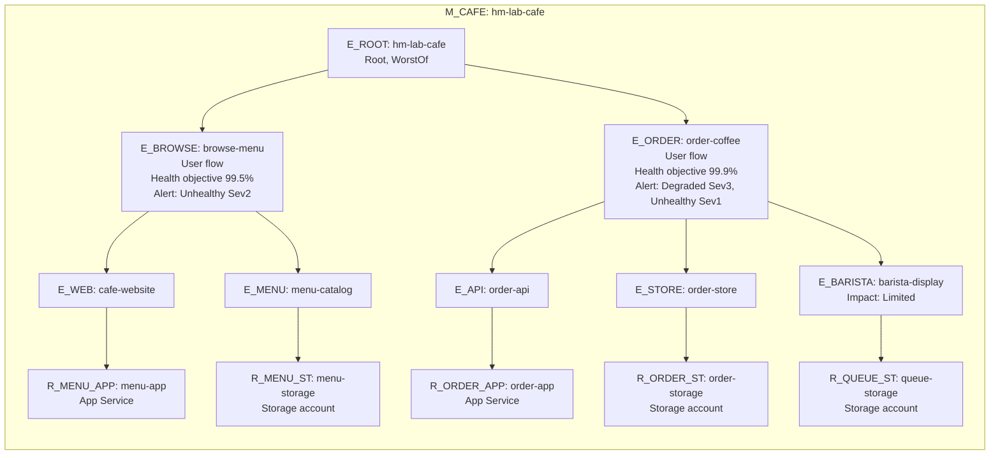

# Health model modelspec: Lab Café (M_CAFE)

Working document for the [health model tutorial](../../HEALTH-MODEL-TUTORIAL.md). The readable summary is [plan.md](plan.md).

## What does health mean for my workload?

- Customers can open the menu and see what's on offer.
- Customers can order a coffee and get an order confirmation, quickly.
- The barista display gets every order; when it doesn't, orders still go through.

## Health modelling strategy

| Model Name | Purpose and platform/workload role | Owner and team/organizational/legal boundary | Tenant, subscription and resource scope | Sources or gap | Status |
|---|---|---|---|---|---|
| M_CAFE `hm-lab-cafe` | Health of the Lab Café customer flows, for the tutorial audience | Tutorial user (single owner, no nested models) | Resource group `rg-healthmodel-tutorial`, region `swedencentral`, same as the workload | S1, S3, S6, G4 | done |

## High-level health model diagram

## Shared source material

| Source ID | What | Locator | Captured | Status |
|---|---|---|---|---|
| S1 | Request: build a health model tutorial into this repo from the health model skills and the MS CLI tutorial, and deploy it end to end | Conversation with the repo maintainer | 2026-11-02 | done |
| S2 | Café app: routes `/`, `/api/menu`, `POST /api/orders`, `GET /api/orders/:id`, `/healthz`; menu blob read, order blob write, barista queue message (failure logged, order still succeeds) | [workloads/cafe/server.js](../../../workloads/cafe/server.js) | 2026-11-02 | done |
| S3 | Workload: App Service B1 Linux with health check `/healthz` and Application Insights agent, storage account (containers `menu`, `orders`, queue `order-events`) reached only over private endpoints through VNet integration (subscription policy disables public storage access), workspace-based Application Insights, two standard availability tests every 5 min from 3 locations | [infra/healthmodel-tutorial/workload.bicep](../../../infra/healthmodel-tutorial/workload.bicep) | 2026-11-02 | done |
| S4 | MS Learn CLI tutorial and `az monitor health-models` reference (extension `health-models` 1.0.0b2, kebab-case JSON for signal groups, alerts, rules) | https://learn.microsoft.com/azure/azure-monitor/health-models/cli | 2026-11-02 | done |
| S5 | Health modelling guidance: three layers, tree with one parent, per-flow copies, signals on data that exists today | healthmodel-plan skill, [WAF health modeling](https://learn.microsoft.com/azure/well-architected/design-guides/health-modeling) | 2026-11-02 | done |
| S6 | `Microsoft.CloudHealth/healthmodels` API `2026-11-01` available, Sweden Central supported | `az provider show -n Microsoft.CloudHealth` | 2026-11-02 | done |
| S7 | Deployment and verification: `build-healthmodel-tutorial.ps1` to `rg-healthmodel-tutorial` in a test subscription; signal states read with `az monitor health-models entity list/show`; scenarios BadRelease, BaristaQueue, NetworkCut via `break-healthmodel-tutorial.ps1`. Log Analytics signals failed with insufficient access for about 10 minutes after the role assignment | [Signals](#signals) Verification column | 2026-11-02 11:51-12:55 UTC | done |
| S8 | User requested five-minute lookbacks for all Lab Café KQL signals, keeping one-minute evaluation | Conversation: "All Lab Café KQL signals" | 2026-11-06 | accepted; deployment pending |

## Flows

| Flow ID | Kind | Description | Routes and dependencies | Sources | Status |
|---|---|---|---|---|---|
| F_BROWSE | User flow | Browse the menu | `GET /`, `GET /api/menu` -> blob `menu/menu.json` | S2 | done |
| F_ORDER | User flow | Order coffee: place and track an order | `POST /api/orders` -> blob `menu/menu.json`, blob `orders/<id>.json`, queue `order-events`; `GET /api/orders/:id` -> blob `orders/<id>.json` | S2 | done |

Place and track are grouped into one flow (S5: group similar flows).

## Derived entity plan

| Model and entity identity/role | Flows, resources and dependencies | Proposed health meaning and user impact | Supporting sources and short derivation | Evidence gaps or conflicts | Intent acceptance | Status |
|---|---|---|---|---|---|---|
| M_CAFE; E_ROOT `hm-lab-cafe`; root | Parent of E_BROWSE, E_ORDER; WorstOf | Worst of both flows | S4 root is implicit | none | accepted, S1 | done |
| M_CAFE; E_BROWSE `browse-menu`; user flow | F_BROWSE; children E_WEB, E_MENU | Unhealthy: customers can't see the menu | S2 | G1 | accepted, S1 | done |
| M_CAFE; E_ORDER `order-coffee`; user flow | F_ORDER; children E_API, E_STORE, E_BARISTA | Degraded: slow or partly failing; Unhealthy: customers can't order | S2 | G1 | accepted, S1 | done |
| M_CAFE; E_WEB `cafe-website`; system component | Web front for F_BROWSE; child R_MENU_APP | Failed menu requests or synthetic customer can't open the menu | S2, S3 | none | accepted, S1 | done |
| M_CAFE; E_MENU `menu-catalog`; system component | Menu blob reads for F_BROWSE; child R_MENU_ST | Menu can't be read from storage | S2 | none | accepted, S1 | done |
| M_CAFE; E_API `order-api`; system component | Order endpoints for F_ORDER; child R_ORDER_APP | Failed or slow order requests, synthetic order fails | S2, S3 | none | accepted, S1 | done |
| M_CAFE; E_STORE `order-store`; system component | Order blob reads and writes; child R_ORDER_ST | Orders can't be saved | S2 | none | accepted, S1 | done |
| M_CAFE; E_BARISTA `barista-display`; system component, impact Limited | Queue `order-events`; child R_QUEUE_ST | Barista misses orders; order still succeeds, so flow is at most Degraded | S2 (failure caught and logged) | none | accepted, S1 | done |
| M_CAFE; R_MENU_APP `menu-app`; resource | App Service `app-cafe-<suffix>` | Health check failing | S3 | none | accepted, S1 | done |
| M_CAFE; R_MENU_ST `menu-storage`; resource | Storage account `stcafe<suffix>` | Storage availability below target | S3 | none | accepted, S1 | done |
| M_CAFE; R_ORDER_APP `order-app`; resource | App Service `app-cafe-<suffix>` (copy for F_ORDER) | Health check failing | S3, S5 per-flow copy | none | accepted, S1 | done |
| M_CAFE; R_ORDER_ST `order-storage`; resource | Storage account (copy for F_ORDER blobs) | Storage availability below target | S3, S5 | none | accepted, S1 | done |
| M_CAFE; R_QUEUE_ST `queue-storage`; resource | Storage account (copy for the queue) | Storage availability below target | S3, S5 | none | accepted, S1 | done |

## Signals

All log signals run on the workspace `law-cafe-<suffix>` that backs Application Insights, with explicit `TimeGenerated > ago(5min)` filters. Metric signals use the signal definitions `sd-app-health-check` and `sd-storage-availability`. All windows are five minutes; refresh every minute.

| Signal | Entity | Kind and data source | Measurement | Degraded and unhealthy rule | Sources or gap | Verification | Status |
|---|---|---|---|---|---|---|---|
| failed-menu-requests | E_WEB | Log Analytics query | `AppRequests`, path empty (root page), `/` or `/api/menu`, `countif(Success == false)`; 5 min | > 0, > 2 | S2, G2 | Baseline 0 (Healthy); NetworkCut 4 (Unhealthy) after fixing empty root path, S7 | done |
| synthetic-browse-failures | E_WEB | Log Analytics query | `AppAvailabilityResults`, test `synthetic-browse-menu`, failed runs; 5 min | > 0, > 2 | S3, S8, G2 | Previous 15-minute window: baseline 0; NetworkCut 5-6 (Unhealthy), S7. Five-minute window not deployed | pending deployment |
| failed-menu-reads | E_MENU | Log Analytics query | `AppDependencies`, blob target, `Data has "/menu/"`, failed calls; 5 min | > 0, > 2 | S2, G2 | Baseline 0; NetworkCut 7 (Unhealthy), S7 | done |
| failed-order-requests | E_API | Log Analytics query | `AppRequests`, `Url has "/api/orders"`, `ResultCode` 5xx (a 404 for a mistyped ID is not an outage); 5 min | > 0, > 2 | S2, G2 | Baseline 0; BadRelease 3 (Unhealthy), S7 | done |
| slow-orders | E_API | Log Analytics query | `AppRequests`, `Url has "/api/orders"`, p95 `DurationMs`, 0 without traffic; 5 min | > 1000 ms, > 3000 ms | S2, S8, G2 | Previous 15-minute window: baseline 100-540 ms (Healthy); cold start 8567 ms (Unhealthy), S7. Five-minute window not deployed | pending deployment |
| synthetic-order-failures | E_API | Log Analytics query | `AppAvailabilityResults`, test `synthetic-order-coffee`, failed runs; 5 min | > 0, > 2 | S3, S8, G2 | Previous 15-minute window: baseline 0; BadRelease 6 (Unhealthy), S7. Five-minute window not deployed | pending deployment |
| failed-order-writes | E_STORE | Log Analytics query | `AppDependencies`, blob target, `Data has "/orders/"`, failed except 404 (order lookup of an unknown ID); 5 min | > 0, > 2 | S2, G2 | Baseline 0; stays 0 during NetworkCut (orders fail earlier at menu read), S7 | done |
| failed-barista-notifications | E_BARISTA | Log Analytics query | `AppDependencies`, queue target, failed; 5 min | > 0, > 2 | S2, G2 | Baseline 0; BaristaQueue 2-3 (Degraded to Unhealthy), S7 | done |
| app-health-check | R_MENU_APP, R_ORDER_APP | Metric `Microsoft.Web/sites` `HealthCheckStatus` | Average; 5 min | < 100, < 50 | S3, G2 | 100 on both entities, also during NetworkCut, S7 | done |
| storage-availability | R_MENU_ST, R_ORDER_ST, R_QUEUE_ST | Metric `Microsoft.Storage/storageAccounts` `Availability` | Average; 5 min | < 99.9, < 99 | S3, G2, G3 | 100 on all three entities, also during NetworkCut (network rejections not counted), S7 | done |

## Gaps and open decisions

| Gap or conflict | Category | Affected items | Known evidence and alternatives | Required resolution and owner | Status |
|---|---|---|---|---|---|
| G1: health objectives 99.5% (browse) and 99.9% (order) | assumption | E_BROWSE, E_ORDER | No user commitment; ordering is the money flow, so stricter | User may change, healthmodel-build applies | new |
| G2: thresholds (any failure degrades, 3+ in a window is unhealthy; p95 1 s / 3 s; health check; storage 99.9% / 99%) | assumption | all signals | Tutorial traffic is 3 synthetic runs per test every 5 min, so one failure is meaningful | Tune after a week of data | new |
| G3: storage availability is account-wide, not per blob container or queue | assumption | R_MENU_ST, R_ORDER_ST, R_QUEUE_ST | Container and queue failures show on the components through dependency queries | none | new |
| G4: model in the same region and resource group as the workload | assumption | M_CAFE | Docs suggest a separate region so the model keeps reporting during a regional outage; kept together for easy cleanup | none for the tutorial | new |
| G5: alert routing | user input | E_BROWSE, E_ORDER | No action group named; alerts fire without notifications | Pass `-ActionGroupId` to the build script | new |
| G6: storage availability doesn't drop when the network path is cut (rejected requests aren't counted) | research/lookup | R_MENU_ST, R_ORDER_ST, R_QUEUE_ST | Observed during NetworkCut, S7; component dependency queries catch it instead | none, kept as a tutorial lesson | done |
| G7: five-minute synthetic windows can miss late test results | assumption | E_WEB, E_API | Tests run every five minutes; an empty window returns 0 failures even if a delayed run failed | Accepted shorter windows for the tutorial, S8 | accepted |

## Intent acceptance

| Concrete intent and affected models/entities | State | Attributable user acceptance/reference | Status |
|---|---|---|---|
| Build and deploy M_CAFE end to end as a tutorial | explicitly accepted | S1: user asked to run the full implementation end to end | done |
