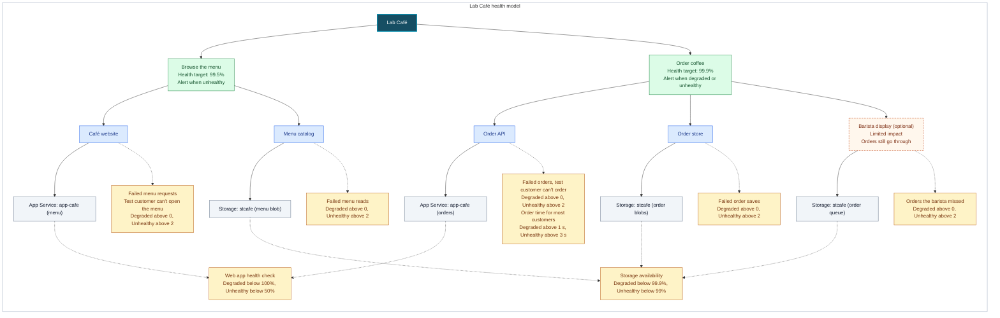

# Health Model for Lab Café

Lab Café is the tiny coffee shop from the [health model tutorial](../../HEALTH-MODEL-TUTORIAL.md). Details and reasoning live in the [modelspec](modelspec.md).

## What does health mean for my workload?

- Customers can open the menu and see what's on offer.
- Customers can order a coffee and get a confirmation, quickly.
- The barista display gets every order; when it doesn't, orders still go through.

## User flows

| User flow | What users do | Depends on | Signals | Health target | Alert |
|---|---|---|---|---|---|
| Browse the menu | Open the café page and see drinks and prices | Café website, Menu catalog | Failed menu requests, test customer can't open the menu, failed menu reads, web app health check, storage availability | 99.5% (assumed) | When unhealthy |
| Order coffee | Order a drink and look up the order | Order API, Order store, optional Barista display | Failed orders, order time for most customers, test customer can't order, failed order saves, orders the barista missed, web app health check, storage availability | 99.9% (assumed) | When degraded or unhealthy |

A test customer opens the menu and orders a flat white every 5 minutes from 3 places in Europe, so the model has something to judge even when nobody else visits.

**Not modelled:** paying for the order (the café doesn't take payments).

## Diagram

**Colors:** green = user flows; blue = parts of the system; orange with a dashed border = optional part; gray = Azure resources; amber = health signals.

Read top to bottom: what customers do, the parts of the café that make it work, then the Azure resources behind them. Each flow has its own copy of the web app and storage, which keeps every part under exactly one parent. What stops a problem only ordering sees from turning browsing red is the parts in blue: their signals only count that flow's requests. If the web app or storage itself fails, both flows show it, as they should. Solid arrows mean **depends on**; dotted arrows connect to **health signals**. Each part takes the worst health of what it depends on. The barista display has **limited impact**: when it fails, ordering is at most degraded, never unhealthy. All signal windows are five minutes, refreshed every minute.

## What happens when something breaks

| If this happens | The model shows | Alert |
|---|---|---|
| The web app loses its private network path to storage | Menu catalog, Café website and Order API turn **Unhealthy**; Browse the menu, Order coffee and Lab Café turn **Unhealthy**. Order store and Barista display stay **Healthy**: orders fail at the menu lookup, before they get that far. The web app and storage resources stay **Healthy** too | Both flow alerts fire |
| The barista queue disappears | Barista display turns **Unhealthy**; Order coffee and Lab Café only **Degraded** (limited impact); Browse the menu stays **Healthy** | Order alert fires (degraded) |
| A bad release makes every order fail | Order API turns **Unhealthy**; Order coffee and Lab Café turn **Unhealthy**; Browse the menu stays **Healthy** | Order alert fires |

## Assumptions

- Ordering is held to 99.9% and browsing to 99.5% of the time healthy.
- One failure in a window is worth a look (degraded), three or more means customers are hurting (unhealthy).
- Most orders should finish within 1 second; 3 seconds is too slow.
- Storage availability is measured for the whole account; failures of a single container or queue show on the parts above it.

## What to do next?

- Deploy and build it with the [tutorial](../../HEALTH-MODEL-TUTORIAL.md).
- Who should be notified when ordering breaks? Pass that action group to the build script.
