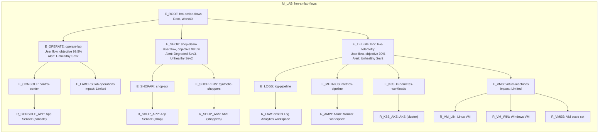

# Health model modelspec: Azure Monitor Lab user flows (M_LAB)

Working document for the lab's user-flow health model. The readable summary is [plan.md](plan.md). Card positions are calculated from the relationships by [infra/modules/health-model-layout.bicep](../../../infra/modules/health-model-layout.bicep). Implemented by [infra/healthmodel-lab/main.bicep](../../../infra/healthmodel-lab/main.bicep), deployed with `scripts/deploy-lab-healthmodel.ps1`.

## What does health mean for my workload?

- A presenter can open the Lab Control Center and run lab operations from it.
- The demo shop app answers checkouts without errors or long waits, and its synthetic shoppers keep running, so APM demos show live data.
- Fresh telemetry from AKS, the VMs and the app keeps arriving in Log Analytics and the Azure Monitor workspace, so dashboards, queries and alerts show the present.

## Health modelling strategy

| Model Name | Purpose and platform/workload role | Owner and team/organizational/legal boundary | Tenant, subscription and resource scope | Sources or gap | Status |
|---|---|---|---|---|---|
| M_LAB `hm-amlab-flows` | User-flow health of the lab for presenters, next to the resource-tier demo model `hm-amlab-workload` (scenario 45), which stays unchanged | Lab operator (single owner, no nested models) | The lab resource group (default `rg-azure-monitor-lab`), model in the lab region | S1, S2, S10, G6 | new |

## High-level health model diagram

## Shared source material

| Source ID | What | Locator | Captured | Status |
|---|---|---|---|---|
| S1 | Request: plan a user-flow health model for the deployed lab and deploy it | Conversation with the repo maintainer | 2026-11-02 | done |
| S2 | Default deployment: Stages A-E on, AI, SRE Agent and Observability Agent off | [lab.config.json.example](../../../lab.config.json.example) `stageToggles` | 2026-11-04 | done |
| S3 | Web app routes. Console: `/`, `/healthz`, `/api/console/config`, `/api/console/version`, `/api/infra/health`, `/api/operations/*`. Shop: `/api/checkout` (402 on a declined payment, about 5% at random, emits event `CheckoutCompleted`). Chaos and demo: `/api/explode` (always 500), `/api/slow`, `/api/dep`, `/api/inefficient`, `/api/console/performance` | [workloads/webapp/Program.cs](../../../workloads/webapp/Program.cs) lines 182-313 | 2026-11-04 | done |
| S4 | Web app: Linux B1, `healthCheckPath: '/'`, codeless Application Insights `appi-amlab` on workspace `law-amlab-appinsights-<sfx>`; platform logs to `law-amlab-central-<sfx>` | [infra/modules/appservice.bicep](../../../infra/modules/appservice.bicep), [infra/main.bicep](../../../infra/main.bicep) | 2026-11-04 | done |
| S5 | Traffic: k6 CronJob `loadgen` every minute (`/`, 404 paths, 15% `/api/explode`); Deployments `otel-caller` (`/`, `/api/slow`, `/api/dep`, 10% `/api/explode`) and `nodeapp-otel` (`/`, `/api/slow`, `/api/dep`, 10% `/api/checkout`), all in namespace `demo`; `hello-frontend` is a static target with no caller | [workloads/k8s](../../../workloads/k8s) | 2026-11-04 | done |
| S6 | Availability test `avail-amlab-appservice` on `/` every 5 min from 5 locations | [infra/main.bicep](../../../infra/main.bicep), [infra/modules/availability-test.bicep](../../../infra/modules/availability-test.bicep) | 2026-11-04 | done |
| S7 | AKS `aks-amlab`: Container Insights to the central workspace, Managed Prometheus to `amw-amlab`; VMs `vm-amlab-lin`, `vmwin<4>` (VM Insights, auto-shutdown 23:00 Romance Standard Time), VMSS `vmss-amlab` (platform metrics only) | [infra/modules/aks.bicep](../../../infra/modules/aks.bicep), [vm-linux.bicep](../../../infra/modules/vm-linux.bicep), [vm-windows.bicep](../../../infra/modules/vm-windows.bicep), [vmss.bicep](../../../infra/modules/vmss.bicep) | 2026-11-04 | done |
| S8 | Lab operations: Control Center starts Container Apps job `job-labops-<s8>` for 8 operations | [infra/modules/lab-console-job.bicep](../../../infra/modules/lab-console-job.bicep), [workloads/webapp/LabOperationCatalog.cs](../../../workloads/webapp/LabOperationCatalog.cs) | 2026-11-04 | done |
| S9 | Break scripts: `break-the-lab.ps1` deallocates VMs, crash-loops `hello-frontend`, floods `/api/explode`; `stop-the-lab.ps1` stops VMs, VMSS, AKS and the web app | [scripts/break-the-lab.ps1](../../../scripts/break-the-lab.ps1), [scripts/stop-the-lab.ps1](../../../scripts/stop-the-lab.ps1) | 2026-11-04 | done |
| S10 | Action group `ag-amlab-email` (lab alert email, automitigation webhook) | [infra/modules/actiongroup.bicep](../../../infra/modules/actiongroup.bicep) | 2026-11-04 | done |
| S11 | Verification: signal queries and metrics read against the deployed lab (`az monitor log-analytics query`, PromQL API, `az monitor metrics list`, last hour), then the deployed model's signal status via `az monitor health-models entity list` | [Signals](#signals) Verification column | 2026-11-04 18:30-19:20 UTC | done |
| S12 | Signal review: every signal judged on whether it answers "is something broken", queries re-run read-only against the deployed lab (24 h of `AppRequests`, `Heartbeat`, `KubePodInventory`, PromQL, platform metrics), then the signal states read from the deployed model | [Signal review](#signal-review) | 2026-11-10 08:25-08:45 UTC | done |

## Flows

| Flow ID | Kind | Description | Routes and dependencies | Sources | Status |
|---|---|---|---|---|---|
| F_OPERATE | User flow | Operate the lab from the Control Center | Console routes on the web app; ARM, Resource Health and Log Analytics lookups; Container Apps job for operations | S3, S8 | new |
| F_SHOP | User flow | Show the shop app live: synthetic shoppers browse and check out, APM shows it | `/` and `/api/checkout` on the web app; callers in AKS | S3, S5 | new |
| F_TELEMETRY | User flow | Show live infrastructure telemetry in Logs, metrics and dashboards | Container Insights and VM Insights to the central workspace; Managed Prometheus to the Azure Monitor workspace | S7 | new |

The chaos routes are not a user flow: they fail on purpose (S3), so no signal counts them.

## Derived entity plan

| Model and entity identity/role | Flows, resources and dependencies | Proposed health meaning and user impact | Supporting sources and short derivation | Evidence gaps or conflicts | Intent acceptance | Status |
|---|---|---|---|---|---|---|
| M_LAB; E_ROOT `hm-amlab-flows`; root | Parent of the three flows; WorstOf | Worst of the flows | Implicit root | none | accepted, S1 | done |
| M_LAB; E_OPERATE `operate-lab`; user flow | F_OPERATE; children E_CONSOLE, E_LABOPS | Unhealthy: presenter can't use the Control Center | S3, S8 | G1 | accepted, S1 | done |
| M_LAB; E_SHOP `shop-demo`; user flow | F_SHOP; children E_SHOPAPI, E_SHOPPERS | Degraded: checkouts fail or are slow, or a shopper app is down; Unhealthy: checkouts keep failing or the shoppers are down. A quiet shop is not a fault | S3, S5, S12 | G1 | accepted, S1 | done |
| M_LAB; E_TELEMETRY `live-telemetry`; user flow | F_TELEMETRY; children E_LOGS, E_METRICS, E_K8S, E_VMS | Unhealthy: dashboards and queries show stale or broken data | S7 | G1 | accepted, S1 | done |
| M_LAB; E_CONSOLE `control-center`; system component | Console routes, child R_CONSOLE_APP | Console requests fail, or the synthetic visitor can't load it | S3, S6 | none | accepted, S1 | done |
| M_LAB; E_LABOPS `lab-operations`; system component, impact Limited | Operations API and job; no resource child (G3) | Operations fail; the rest of the console still works, so at most Degraded | S3, S8 | G3 | accepted, S1 | done |
| M_LAB; E_SHOPAPI `shop-api`; system component | `/` and `/api/checkout`, child R_SHOP_APP | Checkouts fail with server errors or are slow; no checkouts at all reads Unknown | S3, S12 | none | accepted, S1 | done |
| M_LAB; E_SHOPPERS `synthetic-shoppers`; system component | `otel-caller`, `nodeapp-otel` in AKS, child R_SHOP_AKS | Shopper pods aren't running | S5 | G4 | accepted, S1 | done |
| M_LAB; E_LOGS `log-pipeline`; system component | Central workspace ingestion, child R_LAW | Newest Kubernetes and App Service log record is too old | S4, S7 | G4 | accepted, S1 | done |
| M_LAB; E_METRICS `metrics-pipeline`; system component | Managed Prometheus scraping, child R_AMW | Scrape targets down | S7 | G4 | accepted, S1 | done |
| M_LAB; E_K8S `kubernetes-workloads`; system component | Demo namespace pods, child R_K8S_AKS | Containers crash-looping in `demo` | S5, S9 | G4 | accepted, S1 | done |
| M_LAB; E_VMS `virtual-machines`; system component, impact Limited | VM Insights sources, children R_VM_LIN, R_VM_WIN, R_VMSS | A VM that was sending heartbeats went silent; a VM silent for over 2 hours was stopped on purpose (nightly shutdown) and is not a fault. VMs are telemetry sources only, so at most Degraded | S7, S9, S12 | G2 | accepted, S1 | done |
| M_LAB; R_CONSOLE_APP, R_SHOP_APP; resources | Web app `app-amlab-<sfx>` (one copy per flow) | Platform health check failing | S4 | none | accepted, S1 | done |
| M_LAB; R_SHOP_AKS, R_K8S_AKS; resources | AKS `aks-amlab` (one copy per flow) | Node CPU or memory too high | S7 | none | accepted, S1 | done |
| M_LAB; R_LAW; resource | `law-amlab-central-<sfx>` | Platform signal of the workspace | S4 | G5 | accepted, S1 | done |
| M_LAB; R_AMW; resource | `amw-amlab` | Platform signal of the workspace | S7 | G5 | accepted, S1 | done |
| M_LAB; R_VM_LIN, R_VM_WIN, R_VMSS; resources | `vm-amlab-lin`, `vmwin<4>`, `vmss-amlab` | CPU too high | S7 | G2 | accepted, S1 | done |

## Signals

Log signals on E_CONSOLE, E_LABOPS and E_SHOPAPI run on `law-amlab-appinsights-<sfx>`; E_LOGS and E_VMS on `law-amlab-central-<sfx>`; PromQL signals on `amw-amlab`. Refresh every minute.

| Signal | Entity | Kind and data source | Measurement | Degraded and unhealthy rule | Sources or gap | Verification | Status |
|---|---|---|---|---|---|---|---|
| failed-console-requests | E_CONSOLE | Log Analytics query | `AppRequests`, console paths (S3) except `/api/operations/*` (Lab operations counts those, so its limited impact holds) plus empty path and `/index.html` (how the static UI is logged), `ResultCode` 5xx, count; 5 min | > 0, > 5 | S3, G1 | 0 (Healthy), S11 | done |
| console-availability-failures | E_CONSOLE | Log Analytics query | `AppAvailabilityResults`, the lab's availability test (`avail-<prefix>-appservice`, or `test-<prefix>-app` from the staged guide; the deploy script finds it), failed runs; 15 min | > 0, > 4 | S6, G1 | 0 (Healthy); 5 of 25 failed while the app was being published, S11 | done |
| failed-operation-requests | E_LABOPS | Log Analytics query | `AppRequests`, `/api/operations/*`, 5xx count; 15 min | > 0, > 2 | S3, G1 | 0 (Healthy), S11 | done |
| failed-checkouts | E_SHOPAPI | Log Analytics query | `AppRequests`, `/api/checkout`, 5xx count (402 is a business outcome, not a failure); 5 min. A count rather than a rate: 5xx on this route is a fault at any volume | > 0, > 2 | S3, G1 | 0 (Healthy); no checkout traffic in the last 24 h, S12 | done |
| checkout-latency | E_SHOPAPI | Log Analytics query | `AppRequests`, `/api/checkout`, 95th percentile of `DurationMs`; 15 min. Replaces completed-checkouts, which read Unhealthy whenever nobody shopped | > 1000 ms, > 3000 ms | S3, S12 | No checkout requests in the last 24 h: the query returns one row with no value, so the signal is Unknown, not Unhealthy, S12 | done |
| shopper-replicas-missing | E_SHOPPERS | PromQL | `sum(kube_deployment_spec_replicas{...}) - sum(min_over_time(kube_deployment_status_replicas_available{...}[5m]))` for deployments `otel-caller\|nodeapp-otel` in `demo`: desired minus the fewest available in 5 min. A crash-looping pod is ready for a moment between restarts, so a point-in-time value flaps | > 0, > 1 | S5, G4 | 1 (Degraded): `nodeapp-otel` was available in only 6 of the last 60 one-minute samples, G9, S12 | done |
| log-freshness | E_LOGS | Log Analytics query | minutes since newest `KubeNodeInventory` or `AppServiceHTTPLogs` record; 30 min window, 30 when none | > 10, > 20 | S4, S7, G1 | 1-2 minutes (Healthy), S11 | done |
| scrape-targets-up | E_METRICS | PromQL | `(sum(up) / count(up) * 100) or vector(0)`, 0 when nothing answers | < 100, < 90 | S7, G4 | 100 (Healthy); jobs cadvisor, kube-state-metrics, kubelet, node, networkobservability-retina, S11 | done |
| crashlooping-containers | E_K8S | Log Analytics query (central) | `KubePodInventory`, namespace `demo`, `ContainerStatusReason == "CrashLoopBackOff"`, distinct containers; 15 min (a crashing container shows `CrashLoopBackOff` only part of each restart cycle, so 5 min flapped between 1 and 0) | > 0, > 1 | S5, S9, G4 | 1 (Degraded): `nodeapp-otel`, 81 restarts, G9, S12 | done |
| vms-lost-heartbeat | E_VMS | Log Analytics query | VMs (`_ResourceId` of `microsoft.compute/virtualmachines`; AKS agents also write `Heartbeat`) whose newest `Heartbeat` in the last 2 h is older than 10 min. Replaces vms-without-heartbeat, which counted every VM that was off | > 0, > 1 | S7, S12, G2 | 0 (Healthy): both VMs have been deallocated for over 3 days, so neither reported in the window, S12 | done |
| app-health-check | R_CONSOLE_APP, R_SHOP_APP | Metric `Microsoft.Web/sites` `HealthCheckStatus` | Average; 5 min | < 100, < 50 | S4 | 100 on both entities (Healthy), S11 | done |
| node-cpu, node-memory | R_SHOP_AKS, R_K8S_AKS | Metrics `Microsoft.ContainerService/managedClusters` `node_cpu_usage_percentage`, `node_memory_working_set_percentage` | Average; 5 min | > 80, > 95 | S7, G1 | CPU 8-13%, memory 35-43% (Healthy); CPU *requests* are at 97-99% of allocatable, so the k6 `loadgen` CronJob stays Pending, G10, S11 | done |
| vm-cpu | R_VM_LIN, R_VM_WIN | Metric `Microsoft.Compute/virtualMachines` `Percentage CPU` | Average; 5 min | > 80, > 95 | S7, G1 | Linux 0.6-3.6%, Windows 6.7-20.5% (Healthy), S11 | done |
| vmss-cpu | R_VMSS | Metric `Microsoft.Compute/virtualMachineScaleSets` `Percentage CPU` | Average; 5 min | > 80, > 95 | S7, G1 | 0.1-0.2% (Healthy), S11 | done |
| query-availability | R_LAW | Metric `Microsoft.OperationalInsights/workspaces` `AvailabilityRate_Query` | Average; 5 min (reports when queries run; the model's own queries keep it populated) | < 99, < 95 | G5 | 100 (Healthy), S11 | done |
| ingestion-time | R_LAW | Metric `Microsoft.OperationalInsights/workspaces` `Ingestion Time` | Average seconds; 5 min | > 300, > 900 | G5 | 4.6-39 s (Healthy), S11 | done |
| ingestion-limit-used | R_AMW | Metric `Microsoft.Monitor/accounts` `EventsPerMinuteIngestedPercentUtilization` | Average; 5 min | > 80, > 95 | G5 | 0-1.6% (Healthy), S11 | done |

## Signal review

Rule applied (S12): a signal must answer "is something broken" (errors, exceptions, failure rate, latency, saturation, platform health), never "is something being used". A healthy but idle lab reads Healthy or Unknown. Absent traffic or a missing success event is not a fault. The intentional failure routes (`/api/explode`, `/api/slow`, `/api/dep`, `/api/inefficient`, `/api/console/performance`) are in no query: the console, operations and checkout signals select their routes by path, so any other route is out.

| Signal | Decision | Reason |
|---|---|---|
| failed-console-requests, failed-operation-requests, failed-checkouts | keep | 5xx counts on low-volume routes; a rate would swing on a handful of requests |
| console-availability-failures | keep | active probe from 5 locations |
| completed-checkouts | drop | read Unhealthy at 0 only because nobody shopped |
| checkout-latency | new | latency on the checkout route, Unknown when there are no checkouts |
| shopper-replicas-available | change to shopper-replicas-missing | compares with the desired replica count and ignores the readiness flapping of a crash-looping pod |
| log-freshness, scrape-targets-up | keep | pipeline stalls are real faults (max gap in 24 h was 4 min, thresholds 10 and 20) |
| crashlooping-containers | change | window 5 to 15 min, so the flapping `CrashLoopBackOff` state is caught every time |
| vms-without-heartbeat | change to vms-lost-heartbeat | only a VM that stopped within the last 2 hours is a fault; VMs shut down on purpose are not |
| app-health-check, node-cpu, node-memory, vm-cpu, vmss-cpu | keep | platform health and saturation; Unknown while the VMs are off |
| query-availability, ingestion-time, ingestion-limit-used | keep | workspace health and saturation, healthy at 100%, 4 to 39 s and under 2% |

## Gaps and open decisions

| Gap or conflict | Category | Affected items | Known evidence and alternatives | Required resolution and owner | Status |
|---|---|---|---|---|---|
| G1: objectives (99.5% console and shop, 99% telemetry) and thresholds | assumption | all flows and signals | No commitments; telemetry tolerates short gaps | Tune after a week | new |
| G2: VMs shut down nightly at 23:00 and are only telemetry sources | assumption | E_VMS | The signal only counts VMs that went silent within the last 2 hours, so a VM that was shut down on purpose is Healthy after 2 hours (for the first 2 hours after 23:00 the component is Unhealthy, flow Degraded through Limited impact). A crash older than 2 hours is not reported either | none | new |
| G3: Container Apps jobs emit metrics (`Executions`, `RestartCount`, ...) only while an execution runs | research/lookup | E_LABOPS | A job resource entity would be Unknown between runs, so E_LABOPS has no resource child and carries the request signal itself | none | done |
| G4: Managed Prometheus default targets don't keep `kube_pod_container_status_waiting_reason`; `up` and `kube_deployment_status_replicas_available` exist | research/lookup | E_SHOPPERS, E_METRICS, E_K8S | E_K8S uses `KubePodInventory` instead | none | done |
| G5: platform signals for the workspaces | research/lookup | R_LAW, R_AMW | Chosen from `az monitor metrics list-definitions` | none | done |
| G6: model in the lab region and resource group | assumption | M_LAB | Docs suggest a separate region; kept together so the lab teardown removes it | none | new |
| G7: alert delivery (action group, automitigation Logic App) not modelled | assumption | none | Action groups emit no delivery telemetry; Logic App `RunsFailed` exists | Add a flow if delivery matters | new |
| G8: AI, SRE Agent and Observability Agent stages off by default | assumption | none | Not modelled (S2) | Add flows when those stages are on | new |
| G9: `nodeapp-otel` crash-loops (`TypeError: Cannot set property attributes of #<ResourceImpl>` in `@azure/monitor-opentelemetry`, dependency range `^1.10.0` in `workloads/k8s/05-nodeapp-otel.yaml`) | research/lookup | E_SHOPAPI, E_SHOPPERS, E_K8S | Lab defect the model surfaces through crashlooping-containers and shopper-replicas-missing; pinning a working package version is the likely fix. Checkouts get no traffic until then, which reads Unknown on checkout-latency, not Unhealthy | Fix the workload | new |
| G10: AKS CPU requests at 97-99% of allocatable on 2 x 2 vCPU nodes; `loadgen` CronJob Pending | research/lookup | E_SHOPPERS | Usage is low, requests are high; not visible in node CPU usage | Add a node, or lower requests | new |

## Intent acceptance

| Concrete intent and affected models/entities | State | Attributable user acceptance/reference | Status |
|---|---|---|---|
| Plan and deploy M_LAB on the deployed lab | explicitly accepted | S1 | done |
