# Health Model for the Azure Monitor Lab

This model, `hm-amlab-flows`, shows whether the lab can do what presenters use it for. It sits next to the demo model `hm-amlab-workload` ([scenario 45](../../DEMO-SCENARIOS.md#s45)), which groups by resource type and stays as it is. Details and reasoning live in the [modelspec](modelspec.md); the method is taught in the [health model tutorial](../../HEALTH-MODEL-TUTORIAL.md).

## What does health mean for my workload?

- A presenter can open the Lab Control Center and run lab operations from it.
- The demo shop app answers, has a steady stream of test shoppers, and completes checkouts, so the app monitoring demos show live data.
- Fresh data from Kubernetes, the VMs and the app keeps arriving, so dashboards, queries and alerts show the present, not an hour ago.

## User flows

| User flow | What users do | Depends on | Signals | Health target | Alert |
|---|---|---|---|---|---|
| Operate the lab | Open the Control Center, check the lab's health, start, break or restore the lab | Control Center, optional Lab operations | Failed console requests, the test visitor can't load the console, failed operations, web app health check | 99.5% (assumed) | When unhealthy |
| Show the shop app live | Show test shoppers browsing and checking out, with errors and timings in Application Insights | Shop API, Test shoppers | Checkouts failing with server errors, too few completed checkouts, test shopper apps not running, web app health check, cluster too busy | 99.5% (assumed) | When degraded or unhealthy |
| Show live infrastructure data | Show fresh logs, metrics and dashboards from Kubernetes and the VMs | Log pipeline, Metrics pipeline, Kubernetes workloads, optional Virtual machines | Newest log record too old, metric sources not answering, containers crashing, VMs silent, workspaces' own health, cluster and VM load | 99% (assumed) | When unhealthy |

The lab also has endpoints that fail or slow down on purpose (`/api/explode`, `/api/slow`, `/api/inefficient`). No user flow counts them: they're demo props, and their errors are expected.

**Not modelled:** the AI, SRE Agent and Observability Agent stages (off by default), and alert delivery (action groups report nothing the model could read).

## Diagram

```mermaid
flowchart TB
    subgraph M_LAB["Azure Monitor Lab user-flow health model"]
        direction TB
        ROOT["Azure Monitor Lab"]:::model

        OPERATE["Operate the lab<br/>Health target: 99.5%<br/>Alert when unhealthy"]:::journey
        SHOP["Show the shop app live<br/>Health target: 99.5%<br/>Alert when degraded or unhealthy"]:::journey
        TELEMETRY["Show live infrastructure data<br/>Health target: 99%<br/>Alert when unhealthy"]:::journey

        CONSOLE["Control Center"]:::system
        LABOPS["Lab operations (optional)<br/>Limited impact"]:::optional
        SHOPAPI["Shop API"]:::system
        SHOPPERS["Test shoppers"]:::system
        LOGS["Log pipeline"]:::system
        METRICS["Metrics pipeline"]:::system
        K8S["Kubernetes workloads"]:::system
        VMS["Virtual machines (optional)<br/>Limited impact<br/>Shut down every night"]:::optional

        APP_C["App Service: app-amlab (console)"]:::resource
        APP_S["App Service: app-amlab (shop)"]:::resource
        AKS_S["AKS: aks-amlab (shoppers)"]:::resource
        LAW["Log Analytics: law-amlab-central"]:::resource
        AMW["Azure Monitor workspace: amw-amlab"]:::resource
        AKS_K["AKS: aks-amlab (cluster)"]:::resource
        VM_L["VM: vm-amlab-lin"]:::resource
        VM_W["VM: vmwin"]:::resource
        VMSS["VM scale set: vmss-amlab"]:::resource

        SIG_CONSOLE["Failed console requests<br/>Test visitor can't load the console"]:::signal
        SIG_OPS["Failed lab operations"]:::signal
        SIG_SHOP["Checkouts failing with server errors<br/>Too few completed checkouts"]:::signal
        SIG_SHOPPERS["Test shopper apps not running"]:::signal
        SIG_LOGS["Newest log record too old"]:::signal
        SIG_METRICS["Metric sources not answering"]:::signal
        SIG_K8S["Containers crashing"]:::signal
        SIG_VMS["VMs silent for 10 minutes"]:::signal
        SIG_APP["Web app health check"]:::signal
        SIG_AKS["Cluster CPU and memory"]:::signal
        SIG_VMCPU["VM CPU"]:::signal

        ROOT --> OPERATE & SHOP & TELEMETRY
        OPERATE --> CONSOLE & LABOPS
        SHOP --> SHOPAPI & SHOPPERS
        TELEMETRY --> LOGS & METRICS & K8S & VMS
        CONSOLE --> APP_C
        SHOPAPI --> APP_S
        SHOPPERS --> AKS_S
        LOGS --> LAW
        METRICS --> AMW
        K8S --> AKS_K
        VMS --> VM_L & VM_W & VMSS
        CONSOLE -.-> SIG_CONSOLE
        LABOPS -.-> SIG_OPS
        SHOPAPI -.-> SIG_SHOP
        SHOPPERS -.-> SIG_SHOPPERS
        LOGS -.-> SIG_LOGS
        METRICS -.-> SIG_METRICS
        K8S -.-> SIG_K8S
        VMS -.-> SIG_VMS
        APP_C & APP_S -.-> SIG_APP
        AKS_S & AKS_K -.-> SIG_AKS
        VM_L & VM_W & VMSS -.-> SIG_VMCPU
    end

    classDef model fill:#164e63,stroke:#0891b2,color:#ffffff,stroke-width:2px
    classDef journey fill:#dcfce7,stroke:#15803d,color:#14532d
    classDef system fill:#dbeafe,stroke:#2563eb,color:#1e3a8a
    classDef resource fill:#f1f5f9,stroke:#64748b,color:#0f172a
    classDef optional fill:#fff7ed,stroke:#c2410c,color:#7c2d12,stroke-dasharray:5 3
    classDef signal fill:#fef3c7,stroke:#b45309,color:#78350f

    style M_LAB fill:transparent,stroke:#94a3b8
```

**Colors:** green = user flows; blue = parts of the system; orange with a dashed border = optional part; gray = Azure resources; amber = health signals.

Read top to bottom: what presenters do, the parts of the lab that make it work, then the Azure resources behind them. The web app and the cluster serve two flows, so each flow has its own copy of them and keeps only the signals that matter to it. Each part takes the worst health of what it depends on. Optional parts have **limited impact**: when they fail, their flow is at most degraded. Exact thresholds are in the [modelspec](modelspec.md).

## What happens when something breaks

| If this happens | The model shows | Alert |
|---|---|---|
| `break-the-lab.ps1`: VMs stopped, a demo container crash-loops, `/api/explode` flooded | Kubernetes workloads and Show live infrastructure data turn **Unhealthy**, Virtual machines **Unhealthy** (limited impact), Azure Monitor Lab **Unhealthy**. Show the shop app live stays **Healthy**: the flood only hits the endpoint that fails on purpose | Infrastructure data alert fires |
| `stop-the-lab.ps1`: web app, cluster and VMs stopped | Control Center, Shop API, Log pipeline, Virtual machines turn **Unhealthy**; all three flows and Azure Monitor Lab turn **Unhealthy** | All three flow alerts fire |
| Lab operations job fails | Lab operations turns **Unhealthy**; Operate the lab and Azure Monitor Lab only **Degraded** | None |
| Test shopper apps stop | Test shoppers turns **Unhealthy**, then Shop API as completed checkouts dry up; Show the shop app live and Azure Monitor Lab turn **Unhealthy** | Shop alert fires |

## Assumptions

- Operating the lab and the shop demo are held to 99.5%, live data to 99% of the time healthy.
- One failing console or checkout request is worth a look (degraded); a handful means presenters are hurting (unhealthy).
- Logs older than 10 minutes are getting stale, older than 20 minutes are broken.
- The VMs only supply data and shut down every night, so they can't turn a flow red on their own.

## What to do next?

- Deploy with `./scripts/deploy-lab-healthmodel.ps1` (needs a deployed lab).
- Alerts go to the lab's action group `ag-amlab-email`.
